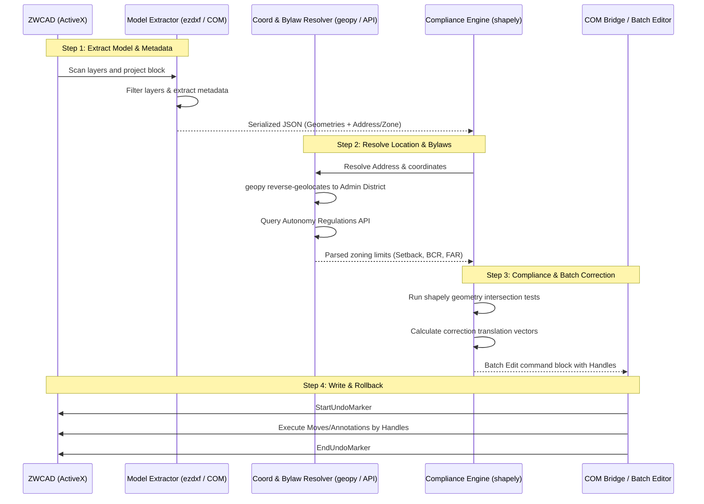

# MCP-001: System Design: Closed-Loop CAD Automation & Autonomy Bylaws Integration

> **Spec ID**: MCP-001
> **Version**: 1.0 (historical retrofit, 2026-07-04)
> **Status**: Historical — design reference, verify current implementation status separately
> **Created**: (predates spec-ID convention; retroactively assigned 2026-07-04 per DOCS-001)

---

This document outlines the detailed technical specifications and data schemas for integrating ZWCAD drawing extraction, coordinate georeferencing, autonomy municipal bylaws queries, and closed-loop batch corrections.

---

## 1. Architectural Architecture

The closed-loop compliance and editing pipeline is divided into four distinct layers:



---

## 2. Coordinate Georeferencing Specification

To bridge the gap between ZWCAD's 2D Cartesian plane (in millimeters/meters) and geographical GIS coordinates (WGS84 Lat/Lon), we define a **Project origin Anchor Block** (`CA_ANCHOR`).

### Metadata Tagging Convention
The CAD template must contain an anchor block named `CA_ANCHOR` on the `CA_METADATA` layer with the following attributes:
*   `OriginX`, `OriginY`: CAD plane coordinate origin (e.g. `0.0`, `0.0`).
*   `Latitude`, `Longitude`: Real-world coordinate mapping of the anchor point (e.g. `37.5512`, `126.9388` for Daeheung-dong, Mapo-gu, Seoul).
*   `Rotation`: Angle offset between the CAD Y-axis and geographical North.
*   `Address`: Text address (e.g., "서울특별시 마포구 대흥동 12").
*   `ZoningDistrict`: Zoning category (e.g., "제2종일반주거지역").

---

## 3. ZWCAD Model Extractor JSON Schema

The Model Extractor serializes active layers and geometric entities into a structured format. Every entity is mapped to its database handle (`Handle`) for downstream modification.

```json
{
  "project": {
    "address": "서울특별시 마포구 대흥동 12",
    "zoning_district": "제2종일반주거지역",
    "anchor": {
      "cad_x": 0.0,
      "cad_y": 0.0,
      "latitude": 37.5512,
      "longitude": 126.9388,
      "rotation": 0.0
    }
  },
  "entities": [
    {
      "handle": "0x1A2",
      "type": "polyline",
      "layer": "CA_WALL",
      "closed": true,
      "points": [
        [0.0, 0.0],
        [10.0, 0.0],
        [10.0, 8.0],
        [0.0, 8.0]
      ],
      "area": 80.0
    },
    {
      "handle": "0x1B3",
      "type": "block_reference",
      "name": "CA_BED_DOUBLE",
      "layer": "CA_FURNITURE",
      "position": [2.0, 3.0],
      "rotation": 90.0,
      "scale": [1.0, 1.0, 1.0]
    }
  ]
}
```

---

## 4. Municipal Bylaws API Resolver

The resolver maps coordinates to local ordinances by contacting the National Law Information Center's Autonomy Regulations API.

### Web API Endpoint & Parameters
*   **Request URL**: `http://www.law.go.kr/DRF/lawSearch.do`
*   **Query Parameters**:
    *   `OC`: API Key (Client credential)
    *   `target`: `lSelectedExt` (for Autonomy Regulations / 자치법규)
    *   `MST`: Ordinance serial number or name query.
    *   `q`: Administrative region name (e.g. "서울특별시 마포구 건축 조례").

---

## 5. Closed-Loop Batch Correction Protocol

When a compliance gap is detected, the engine calculates correction vectors and serializes them into **Batch Edit Commands** referencing the CAD handles.

### Batch Edit Schema
```json
[
  {
    "handle": "0x1B3",
    "action": "move",
    "vector": [-1.0, 0.0, 0.0]
  },
  {
    "handle": "0x1A2",
    "action": "annotate",
    "type": "dimension",
    "start": [0.0, 0.0],
    "end": [0.0, 8.0],
    "text": "Width: 8.0m (Bylaw Compliant)"
  }
]
```

### ActiveX Undo Transaction Guard
To prevent corrupting the active drawing, the COM bridge wraps batch edits using ZWCAD ActiveX Undo markers:
```python
def execute_batch_edits(self, edits):
    self.doc.StartUndoMarker()
    try:
        for edit in edits:
            entity = self.doc.HandleToObject(edit["handle"])
            if edit["action"] == "move":
                dx, dy, dz = edit["vector"]
                entity.Move(APoint(0, 0, 0), APoint(dx, dy, dz))
        self.doc.EndUndoMarker()
    except Exception as e:
        self.doc.EndUndoMarker()
        self.doc.SendCommand("_u\n")  # Undo the entire marker set
        raise e
```
