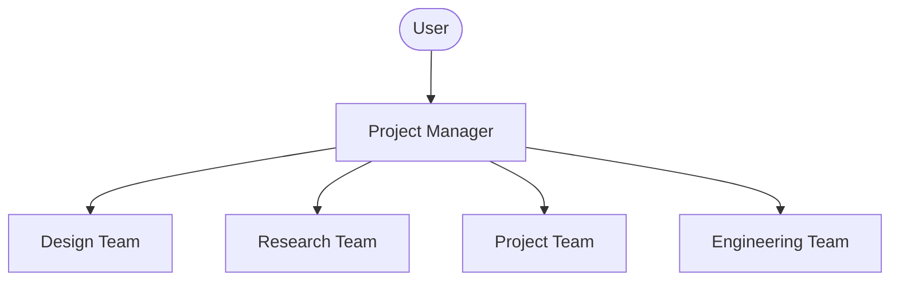

# Co-Architect First-Time User Guide

Welcome to **Co-Architect**! This guide is designed to help first-time users get set up and start collaborating with the AI agent teams in this workspace.

---

## 1. Introduction to Co-Architect

Co-Architect is a multi-agent AI collaboration workspace designed to model the operations of a professional architecture and design firm. Rather than working with a single AI, you interact with an entire virtual team consisting of **16 specialized agents** organized into **4 departments**:



- **Design Team (Lead: design-lead)**: Handles UI/UX, service blueprints, styling, visual tokens, and user experience.
- **Research Team (Lead: analyst)**: Performs market analysis, factual verification, and content writing.
- **Project Team (Lead: project-coordinator)**: Coordinates project scheduling, RFP/proposal acquisition, and technical documentation.
- **Engineering Team (Lead: sketchup-modeler)**: Constructs 3D models (SketchUp) and technical 2D CAD layouts (ZWCAD).

---

## 2. Onboarding Setup (First-Time Installation)

To set up the workspace on your local machine, follow these steps in your terminal:

### Step 1: Clone and Navigate to Workspace Root
```bash
cd /path/to/workspace/co-architect
```

### Step 2: Install Node/Bun Dependencies
We use [Bun](https://bun.sh) to execute our workspace scripts and utilities.
```bash
bun install
```

### Step 3: Set Up Python Environment and ZWCAD dependencies
We use [uv](https://github.com/astral-sh/uv) for fast Python virtual environment and dependency management.
```bash
uv sync --all-extras
```

### Step 4: Configure Local Environment Settings
1. Copy the sample environment file to `.env`:
   ```bash
   cp .env.sample .env
   ```
2. Open `.env` and configure:
   - `ZWCAD_PATH`: Absolute path to your ZWCAD executable (`zwcad.exe`). (Windows only; optional if ZWCAD is in the registry).
   - `ZWCAD_VERSION`: Set to your version (e.g. `2026`).
   - `CAD_LLM_PROVIDER` / `CAD_LLM_API_KEY`: LLM provider (`openai-compatible` | `anthropic` | `gemini` | `custom` | `none`) and its API key — required for backend LLM capabilities.

### Step 5: Enable Git Hooks
We enforce formatting and security rules on every commit. Activate our Git hooks:
```bash
git config core.hooksPath .githooks
```

### Step 6: Validate Setup Compliance
Run our automated workspace audit script to ensure everything is set up correctly:
```bash
bun scripts/audit.ts
```
If you see `✅ All checks passed.`, you are ready to begin!

---

## 3. Daily Collaboration Workflow

All work in Co-Architect follows the **PM Gateway** rule to ensure consistency and prevent agent conflicts.

### Rule 1: Always Start with the PM
Never call or prompt a specialist agent directly. Initiate all tasks by addressing the **Project Manager (PM)**. The PM will classify your request into one of six workflows:
- `workflow: market-research`
- `workflow: design-exploration`
- `workflow: project-acquisition`
- `workflow: design-delivery`
- `workflow: permit-compliance`
- `workflow: interior-execution`

### Rule 2: Multi-Phase Phased Execution
1. **Initiation (Phase 0)**: PM evaluates your task, selects the workflow, and presents an execution plan.
2. **Research (Phase 1)**: The team conducts research and maps requirements.
3. **Gate Review (Phase 2)**: **Crucial Gate.** The PM presents the findings and proposed plan. **Wait for user feedback or approval.**
4. **Execution (Phase 3–4)**: Specialists implement design mockups, 3D models, or 2D drafts.
5. **QA & PR (Phase 5–6)**: PM runs `audit.ts` and syncs the changes to open a Pull Request.

---

## 4. Key Slash Commands

When interacting with the AI in this workspace, you can use these custom commands to automate lifecycle steps:

*   `/sync "feat: description"` — The main pipeline command. It runs tests, validates language compliance, logs the session, commits changes, and opens a GitHub PR.
*   `/changelog "message"` — Appends a new entry under `[Unreleased]` in [CHANGELOG.md](../../CHANGELOG.md).
*   `/memlog "summary"` — Appends a quick update to today's memory log.
*   `/meeting "topic"` — Runs a structured, inline discussion simulating multiple agents role-playing their domain analysis.

### Command Execution Examples & Prompts

#### 1. Running a Multi-Agent Meeting (`/meeting`)
To initiate a brainstorming discussion involving the `design-lead` and `analyst` regarding design tokens:
- **Command:**
  ```text
  /meeting "Review the naming conventions for space tokens" --agents design-lead,analyst --rounds 2
  ```
- **What happens:** The PM launches the `design-lead` and `analyst` agents sequentially. They write their thoughts for 2 rounds, and the PM compiles a summary of spacing standards.

#### 2. Staging a Sync Pipeline (`/sync` / `dev-sync.ts`)
Once you finish implementing code changes and want to open a PR:
- **Command:**
  ```text
  /sync "feat(design-system): add neutral grey variables to design tokens"
  ```
- **What happens:** The script generates `memory/YYYY-MM-DD.md`, logs modifications, runs `bun scripts/audit.ts` to block if standards fail, commits code, pushes to origin, and opens a PR.

---

## 5. Running the CAD Agent & Web Studio

If you want to use the AI CAD drawing automation features:

### 1. Launch the CAD Agent Server

**Option A — Using the skill (recommended):**
```
/cad-server-manager start
```
This uses the CAD Server Manager skill to start the backend server, which boots up on port `3333`.

**Option B — Manual launch:**
```bash
uv run python src/agent/server.py --server
```

### 2. Launch the Web Studio UI
Open the file [src/agent/index.html](../../src/agent/index.html) in any web browser. You can select one of the drawing presets or describe what you want to draw.

### 3. ZWCAD Integration
If you are on Windows and have ZWCAD installed, open ZWCAD and run `APPLOAD` to load [src/lisp/zwcad.lsp](../../src/lisp/zwcad.lsp). This automatically bootstraps the backend server and adds the `CA_AISTUDIO` command to ZWCAD.

---

## 6. MCP Configurations for Claude & Antigravity (Gemini)

Model Context Protocol (MCP) servers allow AI agents to interface with external systems like ZWCAD and the Korean legislation database. Configuring MCP depends on the platform you are running:

### A. Claude Code Configuration (CLI & Desktop)
Claude Code automatically reads the `.mcp.json` file in the project root folder.
1. **Initialize Settings:** Copy `.mcp.json.sample` to `.mcp.json` in the root:
   ```bash
   cp .mcp.json.sample .mcp.json
   ```
2. **Whitelist Project Servers:** By default, Claude Code may block local MCP tools. Add the following to `.claude/settings.local.json` to enable them:
   ```json
   {
     "enableAllProjectMcpServers": true
   }
   ```

### B. Antigravity Configuration (Gemini CLI)
Antigravity does **not** auto-load `.mcp.json`. All MCP servers must be explicitly declared in `.gemini/settings.local.json` (gitignored local file) or `.gemini/settings.json`.
1. **Declare Servers:** Open or create `.gemini/settings.local.json` in the project root and add the servers:
   ```json
   {
     "mcpServers": {
       "zwcad-mcp": {
         "command": "uv",
         "args": ["run", "python", "-m", "cad_intelligence.cad_io.server"],
         "env": {
           "PYTHONPATH": "src"
         }
       },
       "building_skill": {
         "command": "uv",
         "args": ["run", "python", "src/mcp_servers/building_skill.py"]
       }
     }
   }
   ```
2. **Approval Controls:** Tool approvals are configured via `mcp.toolApproval` (e.g. `"Manual"`) in `.gemini/settings.json`.

---

## 7. Language and Git Standards

- **Language Policy**: All official documentation (`docs/`, `agents/`, `skills/`, `AGENTS.md`, `CHANGELOG.md`, `README.md`) MUST be written in English.
- **Exceptions**: Korean-only files are permitted strictly within translation zone directories (e.g. `ko/` or `locales/ko/`). Mixed-language content is allowed.
- **Git Commits**: All commit messages, branch names, and PR titles/bodies must be written in English. Use the approved `/sync` command to push commits.

---

## 8. Troubleshooting & FAQ

#### Q: How do I run Python scripts/tests on macOS since `pywin32` fails to install?
- **A:** The codebase handles missing `pywin32` dependencies gracefully. You can run python code and scripts by using the mock stub environment. If dependency resolution fails, run `uv pip install -r pyproject.toml --override-dependencies` or make sure the `pywin32` package is only designated for Windows markers inside environment environments.

#### Q: The `/sync` command failed because of "pre-commit hook ignored".
- **A:** On macOS or Linux, git hooks must have execute permissions. Run this command to restore them:
  ```bash
  chmod +x .githooks/*
  ```

#### Q: I ran into cp949 encoding errors when running CLI commands in Windows.
- **A:** Prepend UTF-8 encoding configuration to your terminal commands before execution, e.g.:
  ```powershell
  $OutputEncoding = [Console]::OutputEncoding = [System.Text.Encoding]::UTF8; bun scripts/audit.ts
  ```

