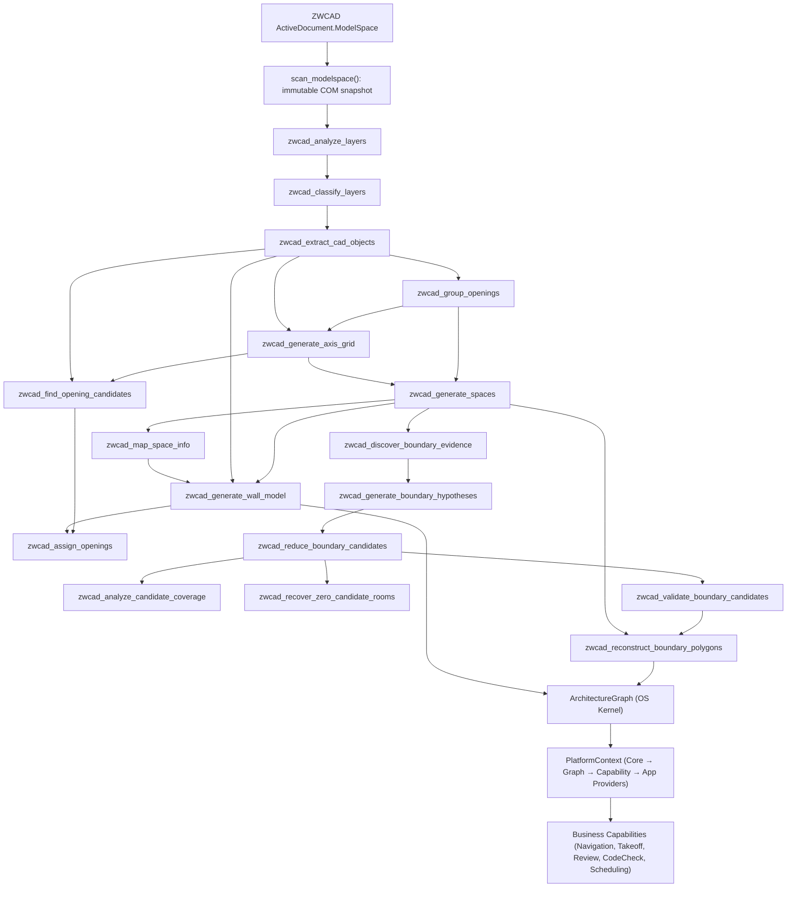

# ZWCAD CAD 엔티티 추출 및 공간 파싱 가이드

> **문서 목적**: 이 가이드는 ZWCAD DWG 도면에서 레이어, 선, 폴리라인, 블록, 문자, 치수 객체를 읽어 `WallSegment`, `DoorEntity`, `WindowEntity`, `SpacePolygon`, `AxisGrid`, `BoundaryEdge` 등 Co-Architect의 CAD Intelligence 데이터 모델로 변환하는 실제 구현 흐름을 설명합니다. 대상 독자는 MCP 툴을 호출하는 AI 에이전트, CAD 자동화 개발자, 도면 추출 결과를 검수하는 건축 실무자입니다.

> **현재 기준**: `src/cad_intelligence/cad_io/handlers/space.py`의 V3 MCP 핸들러 흐름, `src/cad_intelligence/common/models.py`의 데이터 모델, 그리고 **CAD Intelligence Platform Constitution (v5.1 Frozen)** 기반의 OS Kernel Architecture (`ArchitectureGraph`, CQRS `GraphCommand`, `GeometryService`, `PlatformContext`, 5대 비즈니스 캡파빌리티, 8대 CI Fitness Functions)를 기준으로 작성했습니다. V2 원본인 `src/cad_intelligence/cad_io/com_bridge.py`는 레거시 호환용으로 유지되며, 모든 플랫폼 호출은 V3 핸들러와 Platform Layer 서비스/캡파빌리티를 표준으로 사용합니다.

---

## 1. 한눈에 보는 파이프라인

CAD 정보 추출 및 지식 그래프 구축은 "COM 스냅샷 -> 레이어 역할 분류 -> 건축 객체 추출 -> 공간 다각형 생성 -> 개구부/축/경계 보강 -> ArchitectureGraph (OS Kernel) 변환 -> Platform Services & Business Capabilities" 순서로 진행됩니다.



핵심 원칙은 다음과 같습니다.

- **한 번 스캔한 COM 결과를 재사용**합니다. `scan_modelspace()`는 COM 객체를 직접 들고 다니지 않고 `Entry` 값 객체로 고정된 스냅샷을 만듭니다.
- **레이어명만 믿지 않습니다.** 이름 키워드, 엔티티 타입 분포, 블록명, 선가중치/선종류, 공간 분포를 합산해 역할을 분류합니다.
- **사용자 사이드카가 자동 추정보다 우선합니다.** `{file}.layers.json`, `{file}.door-window-patterns.json`, `{file}.room-labels.json`, `{file}.space-info.json`, `{file}.axes.json`은 자동 추출의 보정점입니다.
- **닫힌 방이 나오지 않는 도면도 포기하지 않습니다.** `BOUNDARY-001` 계열 툴과 그래프 기반 경계 보완(`_augment_boundary_graph`)이 방 라벨 주변 증거를 수집하고, 후보 경계선을 필터링·검증·복구한 뒤 재구성 폴리곤을 병합합니다.
- **ArchitectureGraph는 단일 불변(Immutable) OS Kernel입니다.** (ADR-001/004) `GraphIdentity`(sha256 계보 트리)와 `GraphMetadata`를 가지며, 모든 변형은 `GraphCommand` CQRS 엔진을 통해서만 수행됩니다.
- **엄격한 단방향 레이어 의존성 및 캡파빌리티 독립성**을 준수합니다. (ADR-003/005/008) `Applications → Capabilities → Services → Views → ArchitectureGraph` 레이어 순서를 따르며 캡파빌리티 간 직렬 의존은 금지됩니다.

---

## 2. 주요 파일과 책임

| 파일 | 책임 |
|---|---|
| `src/cad_intelligence/cad_io/com_primitives_v3.py` | ZWCAD COM 연결, ProgID 탐색, 좌표 검증, 공통 예외, 기본 ActiveX 브리지 |
| `src/cad_intelligence/cad_io/handlers/space.py` | 레이어 분석/분류, 객체 추출, Feature Store, 개구부 그룹핑, 공간 생성, 축 그리드, 개구부 후보, 벽체 모델, 경계 재구성 MCP 핸들러 (22개 툴) |
| `src/cad_intelligence/cad_io/handlers/drawing.py` | 도면 기본 도구 (선, 폴리라인, 원, 호, 텍스트, 치수, 해치, 블록 삽입, 엔티티 조작, 레이어 관리, 배치 실행 등 33개 툴) |
| `src/cad_intelligence/cad_io/handlers/takeoff.py` | 역산(Quantity Takeoff) — 벽 면적, 바닥 면적, 개구부 공제 |
| `src/cad_intelligence/cad_io/handlers/schedule.py` | 문/창 일람표(Door/Window Schedule) 생성 |
| `src/cad_intelligence/cad_io/handlers/section.py` | 단면 도면(Section Cut) 생성 |
| `src/cad_intelligence/cad_io/handlers/review.py` | 규칙 기반 + LLM 도면 검수(Quality Review) |
| `src/cad_intelligence/cad_io/handlers/closed_loop.py` | 검수 결과 자동 수정(Closed Loop) |
| `src/cad_intelligence/cad_io/handlers/ceiling.py` | 반사천장도(RCP) 생성 |
| `src/cad_intelligence/cad_io/handlers/facade.py` | 입면 메시 생성(Facade Mesh, OBJ/DAE 내보내기) |
| `src/cad_intelligence/cad_io/handlers/compliance.py` | 용도지역 건축법 규제 체크 |
| `src/cad_intelligence/cad_io/handlers/workflow.py` | 엔드투엔드 워크플로우 실행 (review → fix → section → elevation → facade → schedule → takeoff) |
| `src/cad_intelligence/cad_io/handlers/telemetry.py` | 파이프라인 원격측정(Telemetry) 데이터 조회 |
| `src/cad_intelligence/cad_io/adapters/reasoning_adapter.py` | CAD 엔티티 추출 결과(`WallSegment`, `DoorEntity`, `WindowEntity`)를 추론 파이프라인 표준 입결합 구조로 전환하는 `ReasoningInputAdapter` |
| `src/cad_intelligence/common/models.py` | `LayerInfo`, `WallSegment`, `DoorEntity`, `WindowEntity`, `SpacePolygon`, `BoundaryEdge`, `AxisGrid`, `OpeningGroup`, `BoundaryCandidate`, `ValidatedCandidate`, `SemanticObject`, `ArchitectureGraph`, `GraphMetadata`, `GenerationInfo` 등 데이터 모델 |
| `src/cad_intelligence/common/tolerance.py` | 계층형 `ToleranceProfile` (`GeometryTolerance`, `TopologyTolerance`, `SemanticTolerance`) 및 도메인 팩토리(`residential`, `office`, `factory`, `civil`, `legacy`) |
| `src/cad_intelligence/graph/identity.py` | `GraphIdentity` dataclass — `graph_id`, `parent_id`, `revision`, `hash_algorithm`, `content_hash` sha256 계보 관리 (ADR-009) |
| `src/cad_intelligence/graph/commands/` | CQRS 그래프 변형 엔진 (`CommandMetadata`, `GraphCommand` 프로토콜, `AddNodeCommand`, `RemoveNodeCommand`, `UpdateNodeCommand`, `AddEdgeCommand`, `GraphMutationEngine`) |
| `src/cad_intelligence/graph/services/geometry_service.py` | `GeometryService` 및 `GeometryCache` — `graph_revision` 바인딩 기반 SpatialIndex 캐시 및 자동 무효화 관리 (ADR-002) |
| `src/cad_intelligence/graph/services/query/` | 5대 도메인 쿼리 서비스 (`RoomQueryService`, `WallQueryService`, `DoorQueryService`, `SpaceQueryService`, `AnnotationQueryService`) 및 `GraphQueryService` 파사드 |
| `src/cad_intelligence/graph/services/diff_service.py` | `DiffService` 및 `GraphDelta` — 스트리밍 이터레이터(`iter_added_nodes` 등) 기반 그래프 변경분 계산 |
| `src/cad_intelligence/graph/services/history_service.py` | `HistoryService` — 딥카피 버전 프로텍션을 적용한 불변 이력 관리 서비스 |
| `src/cad_intelligence/graph/views/` | `GeometryView`, `TopologyView`, `SemanticView` — 상태가 없고 캐시를 갖지 않는 프로젝션 전용 래퍼 (ADR-007) |
| `src/cad_intelligence/platform/providers/` | 계층화 DI 프로바이더 (`CoreProvider`, `GraphProvider`, `CapabilityProvider`, `ApplicationProvider`) |
| `src/cad_intelligence/platform/context.py` | `PlatformContext` — 플랫폼 레이어별 프로바이더를 관리하고 쿼리 서비스 및 캡파빌리티에 접근을 제공하는 컨테이너 |
| `src/cad_intelligence/platform/capabilities/` | 5대 비즈니스 캡파빌리티 (`NavigationCapability`, `TakeoffCapability`, `ReviewCapability`, `CodeCheckCapability`, `SchedulingCapability`) — 캡파빌리티 간 의존 금지 (ADR-003) |
| `src/cad_intelligence/platform/event_bus.py` | `EventBus` 및 Typed `GraphEvent` (`GraphMutated`, `GeometryChanged`, `TopologyChanged`, `SemanticChanged`) |
| `src/cad_intelligence/rules/` | `RuleEngine`, `RuleRegistry` (YAML 로더) 및 선언적 Rule DSL (`rules/residential/door_height.yaml`) |
| `src/cad_intelligence/geometry/space_geometry.py` | 벽 세그먼트 정합, 지그재그 사다리 Collapse, 이중 면 병합, 개구부 가상 벽 합성, 끝점 용접(v2), polygonization, 그래프 기반 경계 보완(`_augment_boundary_graph`), 경계 재구성 빌더 |
| `src/cad_intelligence/geometry/wall_model.py` | `SpacePolygon`과 `WallSegment`를 벽 중심 모델로 변환, 공유벽 dedup, 문/창 위치 할당, 방향 라벨 |
| `src/cad_intelligence/semantic/opening_evidence.py` | 미분류 개구부 후보를 CAD 증거(문 패널, 스윙 호, 창 스트립, 블록, 슬리브 라인)로 보강 분류 |
| `src/cad_intelligence/features/store.py` | FeatureStore 증거 레포지토리 (ADR-006) — Primitive/Layer/Loop/Component/Object 계층 피처 및 `evidence_ids`/`derivation_ids` 추적 |
| `src/cad_intelligence/features/candidates.py` | `ObjectCandidate` — Feature Store → Pattern Library 연결 브리지 |
| `src/cad_intelligence/features/geometry.py` | 프리미티브/레이어/컴포넌트 피처 계산 |
| `src/cad_intelligence/features/scoring.py` | 벽 점수(wall_score) 산출, 역할 제안, accept/candidate/reject 필터 |
| `src/cad_intelligence/graph/primitive_graph.py` | 원시 엔티티에서 primitive graph 구성 (Feature Store 파이프라인) |
| `src/cad_intelligence/patterns/engine.py` | 패턴 매칭 엔진 (ADR-004 Pattern Library) |
| `src/cad_intelligence/patterns/inference.py` | 추론 엔진 — ObjectCandidate → SemanticObject |
| `tests/test_architecture_fitness.py` | 8대 CI 자동화 아키텍처 피트니스 함수 (레이어 린터, 변형 안전성, 순환 의존성, LOC 제한, 메모리 누수, 결정론적 재구성, 추적성, 커맨드 리플레이) |
| `memory/drawings/*.json` | 도면별 레이어 역할, 공간 정보, 축, 문/창 패턴, 실명 라벨 보정 데이터 |

---

## 3. 등록된 MCP 툴 전체 목록

Co-Architect CAD Server는 총 **64개** MCP 툴을 등록합니다. 이 중 51개는 COM 연결(ZWCAD 실행 필요)이고, 13개는 COM-free (이미 추출된 그래프 데이터로 동작)입니다.

### 3.1 인텔리전스 파이프라인 (22개, space.py)

| 툴 | 설명 |
|---|---|
| `zwcad_analyze_layers` | 레이어 원시 분석 (색상, 선종류, 엔티티 타입 히스토그램, 블록 샘플). 역할 분류 없음 |
| `zwcad_classify_layers` | 레이어 역할 분류 (wall/door/window/dimension/text/fixture/ignore) — 가중치 다중 신호 점수 기반 |
| `zwcad_extract_cad_objects` | 분류된 레이어에서 WallSegment/DoorEntity/WindowEntity 추출 |
| `zwcad_extract_text_labels` | 지정 레이어에서 AcDbText/AcDbMText 텍스트 라벨 추출 |
| `zwcad_build_feature_store` | ModelSpace 전체 스캔 → primitive graph → 연결 컴포넌트 → 피처 계산 → FeatureStore 구축 (COM-free) |
| `zwcad_group_openings` | 한국형 아파트 도면의 복합 개구부(패널+스윙 호+프레임 선)를 OpeningGroup으로 그룹핑 |
| `zwcad_generate_spaces` | 벽/문/창 CAD 객체에서 닫힌 SpacePolygon 자동 감지 (shapely polygonization) |
| `zwcad_generate_axis_grid` | 축정렬 벽 세그먼트를 클러스터링해 안정적인 X/Y 축 그리드 생성 (AXIS-001 Phase A1) |
| `zwcad_find_opening_candidates` | 벽 네트워크의 gap을 탐지하고 문/창/통로/결함으로 분류 (AXIS-001 Phase B1) |
| `zwcad_assign_openings` | 개구부 후보를 벽과 방에 할당, 공유벽 문은 양쪽 방에 연결 (AXIS-001 Phase B2) |
| `zwcad_map_space_info` | 자동 감지 SpacePolygon을 `{file}.space-info.json` 항목과 가중 그리디 매칭 |
| `zwcad_generate_wall_model` | 방 중심 결과를 벽 중심 v2 도메인 모델로 변환 (Wall+Door+Window+Room) |
| `zwcad_generate_wall_elevations` | 방별 4방향 입면 스트립 생성 (Geometry→Topology→Architecture→Presentation→LayoutScene) |
| `zwcad_build_object_candidates` | FeatureStore에서 패턴 매칭 엔진으로 SemanticObject 후보 생성 (COM-free) |
| `zwcad_discover_boundary_evidence` | **BOUNDARY-001 Phase 1**: 방 라벨 주변 벽/중심선/문/창/치수/인접 공간 증거 수집 (진단용) |
| `zwcad_generate_boundary_hypotheses` | **BOUNDARY-001 Phase 2A**: 증거에서 BoundaryCandidate 생성 (읽기 전용, 필터 없음) |
| `zwcad_reduce_boundary_candidates` | **BOUNDARY-001 Phase 2B**: 퇴화/과거리/미지지 중심선/중복 후보 제거, 제거 사유 반환 |
| `zwcad_analyze_candidate_coverage` | **BOUNDARY-001 Phase 2B.1**: 방별 후보 커버리지 진단, zero_reason 분류 |
| `zwcad_recover_zero_candidate_rooms` | **BOUNDARY-001 Phase 2B.2**: zero-candidate 방에 대해 반경 확장 재시도 (radius_expansion_factor=1.5) |
| `zwcad_validate_boundary_candidates` | **BOUNDARY-001 Phase 2C-1**: 기하학적 검증 (Door Crossing, Wall Overlap, Neighbor Consistency, Centerline Agreement) |
| `zwcad_reconstruct_boundary_polygons` | **BOUNDARY-001 Phase 3**: 검증된 후보 → 닫힌 경계 → 기존 공간과 병합 (label > overlap > centroid) |

### 3.2 도면 기본 도구 (33개, drawing.py)

| 툴 | 설명 |
|---|---|
| `zwcad_draw_line` | 선분 그리기 |
| `zwcad_draw_polyline` | 2D 폴리라인 그리기 |
| `zwcad_draw_text` | 단행 텍스트 삽입 |
| `zwcad_draw_mtext` | 다행 텍스트(MText) 삽입 |
| `zwcad_draw_circle` | 원 그리기 |
| `zwcad_draw_arc` | 호 그리기 (각도 단위) |
| `zwcad_draw_aligned_dimension` | 정렬 치수선 그리기 |
| `zwcad_apply_hatch` | 닫힌 폴리라인에 해치 패턴 적용 |
| `zwcad_insert_block` | 블록 참조 삽입 |
| `zwcad_move_entity` | 엔티티 이동 |
| `zwcad_rotate_entity` | 엔티티 회전 |
| `zwcad_copy_entity` | 엔티티 복사 |
| `zwcad_delete_entity` | 엔티티 삭제 |
| `zwcad_mirror_entity` | 엔티티 미러 |
| `zwcad_offset_entity` | 엔티티 오프셋 |
| `zwcad_create_layer` | 레이어 생성 |
| `zwcad_delete_layer` | 빈 레이어 삭제 |
| `zwcad_set_entity_layer` | 엔티티 레이어 변경 |
| `zwcad_list_layers` | 레이어 목록 조회 |
| `zwcad_set_layer_state` | 레이어 freeze/lock 상태 변경 |
| `zwcad_apply_layer_standards` | 표준 건축 레이어 자동 생성 (A-WALL, A-DOOR 등) |
| `zwcad_open_drawing` | DWG 파일 열기 |
| `zwcad_close_drawing` | 활성 도면 닫기 |
| `zwcad_new_drawing` | 새 도면 생성 (선택적 템플릿) |
| `zwcad_save_drawing` | 도면 저장 (선택적 SaveAs) |
| `zwcad_get_active_document_info` | 활성 문서 정보 조회 |
| `zwcad_get_selected_geometry` | 선택된 엔티티 속성/좌표 조회 |
| `zwcad_extract_model` | ModelSpace 엔티티 + 프로젝트 메타데이터 추출 |
| `zwcad_start_undo_marker` | 실행 취소 트랜잭션 시작 |
| `zwcad_end_undo_marker` | 실행 취소 트랜잭션 종료 |
| `zwcad_execute_batch` | 명령 배치를 단일 원자 트랜잭션으로 실행 |
| `zwcad_list_versions` | 도면 파일 백업 버전 목록 (COM-free) |
| `zwcad_restore_version` | 특정 백업 버전 복원 |

### 3.3 COM-free 산출물 핸들러 (9개)

| 툴 | 파일 | 설명 |
|---|---|---|
| `zwcad_generate_takeoff` | takeoff.py | 벽/바닥/개구부 역산 (Excel/CSV/JSON) |
| `zwcad_generate_schedule` | schedule.py | 문/창 일람표 (Excel/CSV/JSON) |
| `zwcad_generate_section` | section.py | 단면 도면 생성 (벽/개구부 교점, 해치, 치수) |
| `zwcad_generate_rcp` | ceiling.py | 반사천장도(RCP) — 다운라이트 배치 그리드 (CEIL-001) |
| `zwcad_generate_facade` | facade.py | 입면 메시 (OBJ/DAE), 다층 지원 (FACADE-001/002) |
| `zwcad_review_drawing` | review.py | 규칙 기반(6) + LLM(4) 품질 검수 |
| `zwcad_apply_fixes` | closed_loop.py | 검수 결과 자동 수정 (dry-run, severity별 auto-approve) |
| `zwcad_run_workflow` | workflow.py | 엔드투엔드 워크플로우 (review→fix→section→elevation→facade→schedule→takeoff) |
| `zwcad_get_telemetry` | telemetry.py | 파이프라인 원격측정(spans/summary/metrics) 조회 |

---

## 4. MCP 툴 실행 순서

### 4.1 기본 추출 경로

일반적인 도면은 다음 순서로 충분합니다.

```text
zwcad_classify_layers
  -> zwcad_extract_cad_objects
  -> zwcad_group_openings          (한국형 아파트 도면에 권장)
  -> zwcad_generate_axis_grid
  -> zwcad_generate_spaces
  -> zwcad_map_space_info
  -> zwcad_generate_wall_model
```

각 핸들러는 필요한 상위 입력이 생략되면 자동으로 이전 단계를 호출합니다. 예를 들어 `zwcad_generate_spaces`에 `walls`, `doors`, `windows`를 넘기지 않으면 내부에서 `zwcad_extract_cad_objects`를 실행합니다. 다만 운영에서는 중간 결과를 저장하고 검수하기 위해 단계별 호출을 권장합니다.

### 4.2 개구부와 연결성까지 필요한 경로

문/창 후보를 축 주소와 방 연결성으로 검증해야 하면 다음 단계를 추가합니다.

```text
zwcad_generate_axis_grid
  -> zwcad_find_opening_candidates
  -> zwcad_assign_openings
```

`zwcad_find_opening_candidates`는 벽 네트워크의 끊어진 구간을 찾고, 근처의 문/창 엔티티 또는 CAD 증거와 비교해 `OpeningCandidate`를 만듭니다. `zwcad_assign_openings`는 후보를 벽과 방에 연결하고, 공유벽이면 양쪽 방의 연결성을 함께 기록합니다.

### 4.3 닫힌 방 추출이 실패하는 도면의 보강 경로

벽이 끊겨 있거나 중심선/라벨만 있는 도면은 BOUNDARY-001 경로를 사용합니다.

```text
zwcad_extract_text_labels
  -> zwcad_discover_boundary_evidence        (Phase 1: 증거 수집)
  -> zwcad_generate_boundary_hypotheses       (Phase 2A: 후보 생성)
  -> zwcad_reduce_boundary_candidates         (Phase 2B: 필터링)
  -> zwcad_analyze_candidate_coverage         (Phase 2B.1: 커버리지 진단)
  -> zwcad_recover_zero_candidate_rooms        (Phase 2B.2: zero-candidate 복구)
  -> zwcad_validate_boundary_candidates       (Phase 2C-1: 기하학적 검증)
  -> zwcad_reconstruct_boundary_polygons      (Phase 3: 폴리곤 재구성 + 병합)
```

BOUNDARY-001 툴은 모두 자동 체이닝을 지원합니다. `validated_candidates`를 생략하면 앞선 단계(Phase 1~2B)를 자동 실행합니다.

### 4.4 Feature Store / 객체 후보 경로

엔티티 기반 피처 추출과 패턴 매칭이 필요한 경우:

```text
zwcad_build_feature_store
  -> zwcad_build_object_candidates
```

`zwcad_build_feature_store`는 COM 필수이며, ModelSpace 전체를 스캔해 원시 그래프(primitive graph)를 구성한 뒤 연결 컴포넌트를 추출하고 피처를 계산합니다. `zwcad_build_object_candidates`는 COM-free이며, FeatureStore에서 패턴 추론 엔진을 실행해 SemanticObject 후보를 만듭니다.

---

## 5. COM 스냅샷과 레이어 분석

### 5.1 COM 연결

V3 브리지는 다음 ProgID를 순서대로 시도합니다.

```text
ZWCAD.Application.2026
ZWCAD.Application
Zwcad.Application
ZwCAD.Application
```

`GetActiveObject()`로 실행 중인 ZWCAD에 붙고, 실패하면 `Dispatch()`를 시도합니다. 연결 실패는 `ZWCADConnectionError`로 보고됩니다. 좌표가 비정상 범위이거나 유한수가 아니면 `BoundaryViolationError`, 레이어 조작 실패는 `LayerOperationError`로 분리됩니다.

### 5.2 `scan_modelspace()` 스냅샷

`scan_modelspace(doc)`는 `ActiveDocument.ModelSpace`를 순회하며 다음 정보를 불변 DTO로 저장합니다.

| DTO | 설명 |
|---|---|
| `Entry` | CAD 엔티티 한 개의 값 객체. 레이어, 핸들, 객체 타입, 선/폴리라인/블록/호/치수 속성을 담습니다. |
| `ModelSpaceScanResult` | 레이어별 `Entry` 묶음, 레이어별 엔티티 타입 카운트, 블록 샘플, 레이어 메타데이터를 담는 스냅샷입니다. |
| `LayerAnalysis` | 레이어 메타, 엔티티 통계, 선가중치/공간분포 신호를 포함한 분석 결과입니다. |

스냅샷은 재반복 가능한 `entities()`를 제공하므로, 분류와 추출 단계가 같은 COM 결과를 공유할 수 있습니다. 이는 대형 DWG에서 COM 속성 읽기 비용을 줄이기 위한 핵심 구조입니다.

### 5.3 `zwcad_analyze_layers` vs `zwcad_classify_layers`

두 툴은 서로 보완 관계입니다.

| 툴 | 역할 | 출력 |
|---|---|---|
| `zwcad_analyze_layers` | 원시 통계 분석 (역할 분류 없음) | 레이어별 색상, 선종류, 엔티티 타입 히스토그램, 블록 샘플명 |
| `zwcad_classify_layers` | 가중치 기반 역할 분류 | 각 레이어의 `classification`, `classification_confidence`, `classification_signals` |

`zwcad_classify_layers`는 `zwcad_analyze_layers`의 출력을 입력으로 받아 역할을 판단합니다. 단독으로 `zwcad_classify_layers`를 호출하면 내부에서 분석을 자동 실행합니다.

---

## 6. 레이어 역할 분류

### 6.1 `zwcad_classify_layers` 입력

```json
{
  "layers_json_path": "memory/drawings/아파트 평면도.layers.json"
}
```

주요 출력은 다음과 같습니다.

```json
{
  "status": "success",
  "layers": [
    {
      "name": "1cen",
      "color": 7,
      "linetype": "Continuous",
      "entity_count": 128,
      "classification": "wall",
      "classification_confidence": 0.82,
      "classification_signals": {
        "wall": 0.334,
        "door": 0.055,
        "window": 0.116,
        "dimension": 0.0,
        "text": 0.0,
        "fixture": 0.0
      }
    }
  ]
}
```

분류 가능한 역할은 다음과 같습니다.

| 역할 | 의미 | 대표 신호 |
|---|---|---|
| `wall` | 벽체/구조/중심선 후보 | `wall`, `cen`, `sec`, `벽`, `구조`, 긴 축정렬 선 |
| `door` | 문 또는 문 패널/스윙 | `door`, `dr`, `문`, `AcDbBlockReference`, `AcDbArc` |
| `window` | 창 또는 슬리브 라인 | `window`, `win`, `창`, 평행 짧은 선, 블록 |
| `dimension` | 치수선 | `AcDbAlignedDimension`, `AcDbRotatedDimension`, `dim`, `치수` |
| `text` | 실명/라벨 문자 | `AcDbText`, `AcDbMText`, `txt`, `label`, `텍스트` |
| `fixture` | 가구/집기 등 추출 제외 대상 | `furniture`, `가구`, `fixture`, `fin`, `hat` |

### 6.2 분류 점수와 수동 보정

자동 분류는 대략 다음 가중치를 사용합니다.

| 신호 | 기본 가중치 | 설명 |
|---|---:|---|
| 이름 키워드 | 0.25 | 레이어명에 포함된 건축 키워드 |
| 주요 엔티티 타입 | 0.30 | 선, 폴리라인, 블록, 텍스트, 치수 객체 분포 |
| 블록명 패턴 | 0.20 | `D900`, `PW2400`, `door`, `window` 등 |
| 선가중치/선종류 | 0.10 | 선가중치 신뢰도가 낮으면 다른 신호로 재분배 |
| 공간 분포 | 0.15 | 축정렬 긴 선, 그리드형 분포 등 |

`classification_confidence < 0.5`이거나 1위/2위 점수 차이가 0.1 미만이면 `AMBIGUOUS_LAYER_ROLE` 예외가 발생합니다. 이때 `{file}.layers.json`의 `layer_roles`에 직접 역할을 지정하면 수동값이 항상 우선합니다.

```json
{
  "layer_roles": {
    "1cen": "wall",
    "2sec": {"role": "wall_exterior"},
    "6fur": "fixture",
    "7dim": "dimension"
  }
}
```

`wall_exterior`, `wall_interior`, `structure_center`, `opening_door`, `opening_window`, `furniture_fixed` 같은 레거시 역할명은 내부에서 표준 역할로 정규화됩니다.

> **레이어명 의미 참고**: 한국 아파트 도면에서 흔히 보이는 레이어명의 실제 의미는
> `docs/reference/opening-dimensions-reference.md` §6에 정리되어 있습니다. 특히
> **`ELE`는 Elevation(입면선, 단차, 방수턱, 레벨 변화)이지 전기(Electrical)가
> 아닙니다** — ELE 레이어가 `wall`로 분류된 도면에서 전기 설비로 오해하지 않도록
> 주의하세요. `WID`는 창문(Window), `CONC`는 콘크리트 벽체, `WAL`은 일반 벽,
> `INSUL`은 단열재를 의미합니다.

### 6.3 하드 제외 키워드

벽으로 오분류되기 쉬운 레이어는 벽 점수를 0으로 낮춥니다.

```text
hatch, fill, fin, finish, fur, 가구, disp, 디스플레이, hat
```

단, 수동 `layer_roles`는 이 하드 제외보다 우선합니다. 실제 도면에서 특정 가구 레이어가 벽체 역할을 겸하는 예외가 있으면 수동 보정 파일에 명시해야 합니다.

---

## 7. CAD 객체 추출

### 7.1 `zwcad_extract_cad_objects`

입력 예시는 다음과 같습니다.

```json
{
  "layers": [],
  "layers_json_path": "memory/drawings/아파트 평면도.layers.json"
}
```

`layers`가 없으면 `zwcad_classify_layers`를 자동 실행합니다. 출력은 `walls`, `doors`, `windows`, `dimensions`, `scanned_entities`입니다.

### 7.2 벽체: `WallSegment`

벽체는 `wall` 레이어의 `AcDbLine`, `AcDbPolyline`, `AcDb2dPolyline`에서 만들어집니다.

```json
{
  "handle": "1A2B",
  "layer": "1cen",
  "start": [0.0, 0.0],
  "end": [4200.0, 0.0],
  "length": 4200.0,
  "thickness": null,
  "is_polyline": false
}
```

폴리라인은 연속 꼭짓점 쌍마다 하나의 벽 세그먼트로 분해됩니다. 닫힌 폴리라인은 마지막 점에서 첫 점으로 돌아가는 세그먼트도 생성합니다. 길이가 0인 세그먼트는 제외됩니다.

### 7.3 문: `DoorEntity`

문 추출은 블록 참조를 우선합니다.

```json
{
  "handle": "2C10",
  "layer": "A-DOOR",
  "position": [3100.0, 1200.0],
  "width": 900.0,
  "rotation": 1.5708,
  "block_name": "D900",
  "swing_direction": null
}
```

처리 규칙은 다음과 같습니다.

- `AcDbBlockReference`가 있으면 `InsertionPoint`, `Rotation`, `Name`, `XScaleFactor`를 사용합니다.
- `XScaleFactor`가 1.0에 가까우면 블록명에서 3~4자리 숫자를 찾아 폭으로 사용합니다. 예: `D900` -> 900mm.
- 블록이 없고 문 레이어에 폴리라인만 있으면 바운딩 박스 중심과 긴 변 길이로 문을 추정합니다.
- 폴리라인 추정은 `MISSING_BLOCK_DEF` 경고를 동반합니다.

### 7.4 창: `WindowEntity`

창도 블록 참조를 우선합니다.

```json
{
  "handle": "3F9A",
  "layer": "A-WINDOW",
  "position": [2100.0, 0.0],
  "width": 2400.0,
  "block_name": "PW2400"
}
```

> **중요: `WindowEntity`에는 `rotation` 필드가 없습니다.** `DoorEntity`와 달리
> 창은 방향 정보를 데이터 모델에 직접 담지 않습니다. 이 때문에 개구부 가상 벽
> 합성 시 창은 근처 벽(500mm 이내)에서 축 방향을 빌려오고, 근처 벽이 없으면
> `OPENING_WALL_SEGMENT_SKIPPED_NO_AXIS` 경고가 발생하며 해당 창은 건너뜁니다.
> 특히 한국 아파트 도면의 WID 레이어는 창 프레임 이중선(외곽 경계선 + 깊이 라인)
> 이므로, 슬리브 라인 폴리시를 사용할 때 이 제한을 인지해야 합니다.

블록이 없으면 창 레이어의 `AcDbLine`을 슬리브 라인으로 보고, 선의 중점과 길이를 창 위치와 폭으로 기록합니다. 이 경로도 `MISSING_BLOCK_DEF` 경고를 냅니다.

### 7.5 개구부 그룹핑: `zwcad_group_openings`

한국 아파트 도면에서 하나의 물리적 문/창은 여러 CAD 엔티티로 표현됩니다 (패널 폴리라인 + 스윙 호 + 프레임 선). `zwcad_group_openings`는 이 엔티티들을 공간 근접성과 기하학적 패턴 인식으로 하나의 `OpeningGroup`으로 클러스터링합니다.

```json
{
  "kind": "door",
  "handles": ["B52A", "B52B", "B52C"],
  "position": [5200.0, 3300.0],
  "width": 900.0,
  "height": 2100.0,
  "rotation": 1.5708,
  "swing_direction": "left",
  "anchor_type": "block",
  "layer": "DOOR",
  "confidence": 0.92
}
```

`zwcad_extract_cad_objects` 이후, `zwcad_generate_spaces` 이전에 실행합니다. 그룹핑 결과는 `zwcad_generate_spaces`에 `grouped_openings`로 전달할 수 있습니다.

### 7.6 치수와 원시 스캔

`AcDbAlignedDimension`, `AcDbRotatedDimension`은 `dimensions`에 별도로 수집됩니다. 치수는 경계 증거 발견, 검수, 향후 치수 기반 보정에 사용됩니다. `scanned_entities`는 후속 그룹핑/디버깅용 원시 레코드이며, 일반 소비자는 `walls`, `doors`, `windows`, `dimensions`를 우선 사용합니다.

### 7.7 문/창 패턴 사이드카

`{file}.door-window-patterns.json`이 있으면 자동 추출 결과를 패턴 기반 결과로 대체할 수 있습니다.

```json
{
  "door_patterns": {
    "type_1_arc_swing": {
      "search_layers": ["A-DOOR", "7dim"]
    },
    "type_2_named_block": {},
    "type_3_curved_cluster": {
      "search_layers": ["A-DOOR"]
    }
  },
  "window_patterns": {
    "type_1_horizontal_parallel_lines": {
      "search_layers": ["A-WINDOW"]
    },
    "type_2_framed_parallel_lines": {
      "search_layers": ["A-WINDOW"]
    },
    "type_3_vertical_parallel_lines": {
      "search_layers": ["A-WINDOW"]
    }
  }
}
```

이 파일은 한국 아파트 도면처럼 문/창이 표준 레이어에 있지 않거나, 문 스윙 호와 프레임 선이 여러 레이어에 흩어진 경우에 유용합니다.

---

## 8. 실명 텍스트 추출

### 8.1 `zwcad_extract_text_labels`

실명은 명시된 레이어에서만 추출합니다. 기본 레이어명은 없습니다.

```json
{
  "search_layers": ["A-TEXT", "ROOM-NAME", "6txt"]
}
```

출력은 보통 다음 형태입니다.

```json
{
  "status": "success",
  "text_labels": [
    {
      "handle": "4A10",
      "layer": "A-TEXT",
      "text": "거실",
      "position": [5200.0, 3300.0]
    }
  ],
  "leader_lines": []
}
```

### 8.2 `{file}.room-labels.json`

`LABEL_VORONOI`, `LABEL_ANCHORED_HYBRID` 모드는 방 이름 라벨을 식별하기 위해 사이드카를 사용합니다.

```json
{
  "text_layers": ["A-TEXT", "6txt"],
  "room_name_includes": ["거실", "침실", "안방", "주방", "욕실", "발코니"],
  "room_name_excludes": ["확장", "천장고", "마감", "치수"]
}
```

`room_name_includes`가 있으면 포함 목록에 맞는 텍스트만 방 라벨로 사용합니다. 없으면 제외 목록에 걸리지 않는 텍스트를 후보로 봅니다.

---

## 9. 공간 다각형 생성

### 9.1 `zwcad_generate_spaces`

대표 입력은 다음과 같습니다.

```json
{
  "walls": [],
  "doors": [],
  "windows": [],
  "layers": [],
  "axis_grid": null,
  "wall_processing_mode": "endpoint_cluster"
}
```

`walls`, `doors`, `windows`가 없으면 객체 추출을 자동 실행합니다. `axis_grid`가 있으면 벽 중심선을 축에 스냅하고, 반환되는 `SpacePolygon.boundary_edges`와 `axis_refs`를 채웁니다.

### 9.2 벽 필터링

벽 필터링은 두 가지 경로가 있습니다.

| 경로 | 사용 조건 | 동작 |
|---|---|---|
| Feature-based filter | `wall_components` 전달 | `zwcad_build_feature_store`의 컴포넌트 점수를 사용해 `accept`, `candidate`, `reject`를 적용 |
| Legacy confidence filter | `layers` 전달, endpoint cluster 모드 | `classification_confidence >= 0.4`는 accept, `0.25~0.4`는 후보로 두고 기하 검증 |

아무 필터 정보도 없으면 기존 호환성을 위해 모든 벽을 사용합니다.

### 9.3 벽 처리 모드

`wall_processing_mode`는 `space_geometry.WallProcessingMode` 이름을 소문자로 넘깁니다.

| 모드 | 용도 | 주의 |
|---|---|---|
| `endpoint_cluster` | 기본 경로. 지그재그 collapse + 이중 면 병합 + 개구부 가상 벽 합성 + v2 끝점 용접 + polygonization | 축 그리드와 함께 사용 가능 |
| `solid_union` | 벽 면을 합집합으로 처리하는 대안 경로. 핸들러에서 `_build_space_polygons_solid_union`로 분기 | 현재 `axis_grid`/`divider_lines`와 함께 쓰면 `SOLID_UNION_UNSUPPORTED_PARAM` |
| `label_voronoi` | 실명 라벨 기반 Voronoi 근사 | `room-labels` 사이드카 필요, 축 그리드 미지원 |
| `label_anchored_hybrid` | 라벨, 벽, 리더라인을 결합한 하이브리드 | `room-labels` 사이드카 필요, 축 그리드 미지원 |

### 9.4 `_build_space_polygons` 파이프라인 상세 (endpoint_cluster 모드)

기본 모드인 `endpoint_cluster`의 내부 파이프라인은 다음 단계로 구성됩니다.

```
입력: wall_segments, openings, axis_grid?, divider_lines?
  │
  ▼
Step 1:  WallSegment → shapely LineString 변환
Step 1b: 중복 제거 (Grid Hash, DEDUP_TOL=5mm)
Step 1c: 길이 0 세그먼트 제거 (ZERO_LENGTH_WALL_EPSILON_MM=1e-6)
  │
  ▼
Step 1.5a: 지그재그 사다리 Collapse (_collapse_zigzag_ladders)
         CONC 스타일 이중선 지그재그 도법을 단일 중심선으로 압축
  │
Step 1.5b: 벽 면 쌍 병합 (_merge_wall_face_pairs)
         근접 평행 이중선(두 벽면)을 하나의 중심선으로 병합
  │
Step 1.5c: 개구부 가상 벽 합성 (_openings_to_wall_segments)
         문/창 위치에 벽 gap을 메우는 가상 벽 세그먼트 생성
  │
  ▼
Step 2:   끝점 용접 — v2 (STRtree + Union-Find + Medoid clustering)
  │
Step 2.5: [선택] 축 스냅 (axis_grid 제공 시)
  │
  ▼
Step 3:   문/창 gap 브리지
  │
Step 3.5: [선택] 구분선 주입 (divider_lines 제공 시, SPACE-001)
  │
  ▼
Step 4:   shapely polygonize_full()
         dangling → UNCLOSED_WALLS 예외
  │
  ▼
Step 5:   슬라이버 필터링 (MIN_SPACE_AREA_MM2=1,000,000), auto_id 할당
Step 6:   포함 폴리곤 → hole 정규화
Step 7:   [선택] 리더 라인-라벨 연결
  │
  ▼
출력: (list[SpacePolygon], list[ExceptionReport])
```

#### Step 1.5a: 지그재그 사다리 Collapse

콘크리트 벽체 도법(CONC 스타일)은 두 벽면을 지그재그(run) 단락으로 그리는데, 이를 단일 중심선으로 압축합니다. Union-Find + 최근접 축 이웃 탐색 + 대각선 밴드 각도 테스트를 사용합니다.

| 상수 | 값 | 설명 |
|---|---|---|
| `LADDER_CONNECTOR_MAX_MM` | 60 | 연결선(run) 최대 길이 |
| `LADDER_GAP_MAX_MM` | 250 | 두 면 사이 최대 간격 |
| `LADDER_NEIGHBOR_TOL_MM` | 40 | 이웃 탐색 허용 오차 |
| `LADDER_MIN_FACE_OFFSET_MM` | 3 | 최소 면 오프셋 |
| `LADDER_RUNG_BAND_MIN_DEG` | 20 | 수평 사다리 각도 하한 |
| `LADDER_RUNG_BAND_MAX_DEG` | 70 | 수평 사다리 각도 상한 |

#### Step 1.5b: 벽 면 쌍 병합

가까운 평행 이중선(한 물리적 벽의 두 면)을 하나의 중심선으로 병합합니다. 끝단 cap 세그먼트를 자동 제거합니다.

| 상수 | 값 | 설명 |
|---|---|---|
| `WALL_FACE_MAX_THICKNESS` | 250mm | 병합 대상 최대 두께 |
| `WALL_FACE_MIN_OVERLAP_RATIO` | 0.5 | 최소 겹침 비율 |
| `WALL_FACE_PARALLEL_TOLERANCE_DEG` | 5.0° | 평행 판정 각도 허용치 |

#### Step 1.5c: 개구부 가상 벽 합성

문/창 개구부 위치에 벽 경계를 연속적으로 만드는 가상 벽 세그먼트를 합성합니다. v2는 **anchor-based gap span** 메커니즘을 사용합니다.

1. **방향 결정**: 문은 자체 `rotation` 필드 사용. 창은 근처 벽(500mm 이내)에서 축 방향 차용. 근처 벽이 없으면 `OPENING_WALL_SEGMENT_SKIPPED_NO_AXIS`로 건너뜀.
2. **투영**: 개구부 위치를 가장 가까운 벽의 무한 직선으로 투영.
3. **1차 — anchor-based gap span**: 개구부 양쪽의 벽 끝점(anchor)을 찾아 실제 벽 gap을 가상 벽으로 연결. `300mm <= gap <= 1200mm` 범위만 적용.
4. **2차 — stub fallback**: anchor span 범위 밖이면, 개구부 폭 기반 stub 생성. 폭이 300mm 미만이면 800mm 기본값 사용.

| 상수 | 값 | 설명 |
|---|---|---|
| `OPENING_AXIS_SEARCH_TOL_MM` | 500 | 창이 벽 축 방향을 차용하는 최대 거리 |
| `OPENING_GAP_SPAN_MIN_MM` | 300 | anchor span 최소 gap |
| `OPENING_GAP_SPAN_MAX_MM` | 1200 | anchor span 최대 gap |
| `OPENING_MIN_VIRTUAL_WALL_MM` | 300 | 최소 가상 벽 길이 |
| `OPENING_DEFAULT_WIDTH_MM` | 800 | 폭이 너무 작을 때 기본값 |
| `OPENING_PROXIMITY_TOL` | 200 | 개구부 근접 판정 거리 |

모든 합성 세그먼트는 `SYNTHESIZED_OPENING_WALL_SEGMENT` 경고와 함께 기록됩니다. `reason` 필드로 `opening_gap_bridge` (anchor span 성공) 또는 `stub_fallback`을 구분합니다.

#### Step 2: v2 끝점 용접

`_weld_endpoints_v2`는 STRtree 공간 인덱스 + Union-Find 연결 성분 + Medoid 클러스터링을 사용하는 O(N log N) 알고리즘입니다. 최대 3패스까지 반복합니다.

| 상수 | 값 | 설명 |
|---|---|---|
| `CORNER_SNAP_TOL` | 150mm | 끝점 용접 허용 거리 |
| `MAX_WELD_PASSES` | 3 | 최대 용접 반복 횟수 |

#### Step 3: 문/창 gap 브리지

용접 후에도 남은 작은 gap(문/창 위치)을 원자적으로 탐지하고 합성 브리지를 삽입합니다.

| 상수 | 값 | 설명 |
|---|---|---|
| `DOOR_BRIDGE_TOL` | 1200mm | gap 브리지 최대 거리 |
| `OPENING_PROXIMITY_TOL` | 200mm | 개구부 근접 판정 거리 |

#### Step 5: 슬라이더 필터

`MIN_SPACE_AREA_MM2 = 1,000,000` (1 m²) 미만의 폴리곤은 노이즈로 간주해 제거합니다. `AUTO_ID_ROUND_MM = 100.0`으로 중심점 좌표를 반올림해 결정론적 auto_id를 부여합니다.

### 9.5 `SpacePolygon` 출력

```json
{
  "auto_id": "Room-1d1f234c",
  "polygon_points": [[0.0, 0.0], [4200.0, 0.0], [4200.0, 3600.0], [0.0, 3600.0]],
  "holes": [],
  "area": 15120000.0,
  "perimeter": 15600.0,
  "centroid": [2100.0, 1800.0],
  "wall_segment_handles": ["1A2B", "1A2C"],
  "boundary_edges": [],
  "axis_refs": {},
  "source": "geometry",
  "category": "void",
  "room_name": null,
  "confidence_score": null
}
```

면적 단위는 CAD 도면 단위가 mm라고 가정할 때 `mm²`입니다. `m²` 변환은 `area / 1_000_000`, 평 변환은 `m² / 3.305785`로 계산합니다.

`category`는 `void` (벽으로만 감지, 실명 없음), `room` (space-info 매핑됨) 등입니다. `source`는 `geometry` (polygonization), `reconstructed` (BOUNDARY-001 복원), `label_voronoi` (Voronoi 기반)입니다.

### 9.6 `BoundaryEdge`와 `axis_refs`

AXIS-001 보강이 적용되면 `SpacePolygon`은 각 경계 에지를 별도 객체로 들고 있습니다.

```json
{
  "start": [0.0, 0.0],
  "end": [4200.0, 0.0],
  "axis_id": "Y-001",
  "orientation": "horizontal",
  "source_handles": ["1A2B"],
  "evidence_state": "agree",
  "confidence": 0.94
}
```

`evidence_state`는 단순 점수가 아니라 증거 상태입니다.

| 상태 | 의미 |
|---|---|
| `agree` | 경계선과 축/벽 증거가 일치 |
| `disagree` | 축 또는 벽 증거와 충돌 |
| `unavailable` | 비교할 증거가 부족 |
| `not_applicable` | 축 정합 대상이 아님 |

---

## 10. 축 그리드와 개구부 후보

### 10.1 `zwcad_generate_axis_grid`

축 그리드는 축정렬 벽 세그먼트를 클러스터링해 안정적인 X/Y 기준선을 만듭니다.

```json
{
  "walls": [],
  "doc_name": "아파트 평면도.dwg",
  "profile": {
    "cluster_tol": 50.0,
    "double_wall_gap": 200.0
  }
}
```

출력 구조는 다음과 같습니다.

```json
{
  "axis_grid": {
    "x_axes": [
      {
        "uid": "axis-x-a1",
        "id": "X-001",
        "orientation": "vertical",
        "position": 0.0,
        "wall_thickness": 200.0,
        "source_handles": ["1A2B", "1A2C"],
        "confidence": 0.91
      }
    ],
    "y_axes": [],
    "snap_tolerance": 50.0,
    "schema_version": "1.0"
  }
}
```

`doc_name`이 있으면 `memory/drawings/{stem}.axes.json`을 읽어 기존 축과 reconcile합니다. 큰 위치 이동은 `AXIS_POSITION_DRIFT` 예외로 보고될 수 있습니다. 기본 `snap_tolerance`은 50.0mm입니다.

### 10.2 `zwcad_find_opening_candidates`

이 단계는 벽 네트워크의 gap을 찾아 문/창/통로/결함 후보로 분류합니다.

```json
{
  "walls": [],
  "doors": [],
  "windows": [],
  "axis_grid": {}
}
```

출력 예시는 다음과 같습니다.

```json
{
  "candidates": [
    {
      "gap_endpoints": [[1200.0, 0.0], [2100.0, 0.0]],
      "kind": "door",
      "axis_id": "Y-001",
      "span": ["X-001", "X-002"],
      "offset": 1200.0,
      "width": 900.0,
      "evidence": {"door": 0.9, "window": 0.0},
      "evidence_state": "agree"
    }
  ]
}
```

`kind`는 `door`, `window`, `passage`, `unknown`, `defect` 중 하나입니다. 명시적 문/창 엔티티로 분류되지 않은 후보는 `scan_opening_evidence`로 원시 CAD 증거(문 패널, 스윙 호, 창 스트립, 블록, 슬리브 라인)를 스캔해 한 번 더 보강합니다.

### 10.3 `zwcad_assign_openings`

개구부 후보를 벽과 방에 할당합니다. 공유벽은 `Wall.room_ids` 양쪽에 연결되므로, 하나의 문이 두 방의 연결 그래프 에지가 될 수 있습니다.

대표 예외는 다음과 같습니다.

| 예외 | 의미 |
|---|---|
| `LOW_CONFIDENCE_OPENING` | gap은 있으나 co-located 문/창 증거가 부족 |
| `ORPHAN_OPENING_NO_WALL` | 후보가 붙을 만한 벽을 찾지 못함 |
| `ROOM_UNREACHABLE` | 방 그래프에서 현관/시작 방으로부터 도달 불가 |

---

## 11. 공간 정보 매핑과 벽 중심 모델

### 11.1 `{file}.space-info.json`

자동 추출된 `SpacePolygon`은 도면의 실명/면적/위치 힌트와 매핑해야 다운스트림에서 안정적으로 사용할 수 있습니다.

```json
{
  "room_info": [
    {
      "name": "거실",
      "area_m2": 24.5,
      "position_hint": [5200.0, 3300.0],
      "aspect_ratio": 1.6
    }
  ],
  "mapping": [
    {
      "room_info_name": "거실",
      "auto_id": "space_001",
      "score": 0.87,
      "confirmed": false
    }
  ]
}
```

### 11.2 `zwcad_map_space_info`

매핑 점수는 크기 0.5, 종횡비 0.2, 위치 힌트 0.1, 형태 정규성 0.2를 합산합니다. 동점이나 유사 점수로 자동 확정이 위험하면 `AMBIGUOUS_SPACE_SIZE_MATCH`를 냅니다.

### 11.3 `zwcad_generate_wall_model`

이 단계는 방 중심 결과를 벽 중심 도메인 모델로 변환합니다.

```text
SpacePolygon + WallSegment + DoorEntity + WindowEntity + mapping
  -> Wall + Door + Window + Room
```

주요 처리 내용은 다음과 같습니다.

- `SpacePolygon.boundary_edges` 또는 폴리곤 에지를 `WallSegment`와 매칭합니다 (2단계 기하학적 공선성 매치).
- 같은 경계를 공유하는 두 방의 벽은 하나의 `Wall`로 dedup하고 `room_ids`에 양쪽 방을 기록합니다.
- 축정렬 기준으로 `N/S/E/W` 또는 `Wall A/B/C/D` 방향 라벨을 붙입니다.
- 문/창이 가까운 벽을 찾지 못하면 `ORPHAN_OPENING`을 보고합니다.
- `{file}.space-extra.json`의 높이, 마감, 보조 정보를 병합합니다.

| 상수 | 값 | 설명 |
|---|---|---|
| `EDGE_MATCH_TOL` | 150mm | 에지-세그먼트 매칭 허용 거리 |
| `EDGE_MATCH_ANGLE_TOL_DEG` | 2.0° | 공선성 각도 허용치 |
| `AXIS_ALIGN_TOLERANCE_DEG` | 5.0° | 방향 라벨 축정렬 판정 |
| `ORPHAN_TOLERANCE_MM` | 100.0mm | 문/창-orphan 판정 거리 |

---

## 12. 경계 증거 발견과 재구성

### 12.1 언제 필요한가

다음 상황에서는 단순 polygonization만으로 방이 닫히지 않습니다.

- 벽체 한쪽이 문/창 gap 때문에 끊겨 있지만 브리지 증거가 부족함
- 중심선 레이어(`1cen`)만 있고 실제 벽면선이 부족함
- 방 라벨은 있지만 벽 레이어가 가구/해치/치수 레이어와 섞여 있음
- 오픈플랜, L자형, 복도형, concave 공간처럼 하나의 큰 폴리곤을 여러 실로 나눠야 함

### 12.2 `zwcad_discover_boundary_evidence` (Phase 1)

닫힌 `SpacePolygon` 안에 포함되지 않은 방 라벨을 대상으로 주변 증거를 수집합니다.

```json
{
  "spaces": [],
  "walls": [],
  "doors": [],
  "windows": [],
  "dimensions": [],
  "search_radius": 6000.0
}
```

증거 종류는 보통 다음과 같습니다.

| 증거 | 설명 |
|---|---|
| `wall_segment` | 구조/벽 레이어의 실제 벽 후보 |
| `centerline` | `cen` 계열 중심선 |
| `door` | 라벨 주변 문 |
| `window` | 라벨 주변 창 |
| `dimension` | 라벨 주변 치수 |
| `nearest_space` | 이미 해결된 가장 가까운 공간 |

이 단계는 진단용입니다. 폴리곤을 만들거나 신뢰도를 확정하지 않습니다.

### 12.3 `zwcad_generate_boundary_hypotheses` (Phase 2A)

각 벽/중심선 증거에서 하나의 `BoundaryCandidate`를 생성합니다.

```json
{
  "id": "cand-001",
  "room_id": "거실",
  "room_label": "거실",
  "start": [0.0, 0.0],
  "end": [4200.0, 0.0],
  "evidence_kind": "wall_segment",
  "source_handle": "1A2B",
  "confidence_state": "candidate",
  "rationale": ["near_room_label", "parallel_to_axis"]
}
```

읽기 전용입니다. 필터링, 병합, 점수화를 수행하지 않습니다.

### 12.4 `zwcad_reduce_boundary_candidates` (Phase 2B)

구조적으로 부적합한 후보를 제거하고 근접 중복을 병합합니다.

| 제거 사유 | 조건 |
|---|---|
| `degenerate_length` | 세그먼트 길이 < `min_length` (기본 200mm) |
| `too_far_from_label` | 라벨까지 거리 > `max_distance` (기본 3000mm) |
| `unsupported_centerline` | 중심선 후보에 2500mm 이내 문/치수 증거 없음 |
| `duplicate_merge` | 동일 방의 두 후보 시작/끝점이 100mm 이내 |

모든 제거/병합은 이유와 함께 반환되며, 원본 후보는 수정하지 않습니다.

### 12.5 `zwcad_analyze_candidate_coverage` (Phase 2B.1)

방별 후보 커버리지를 진단합니다. `candidate_coverage` KPI = (후보가 1개 이상인 방 수 / 전체 방 수).

zero-candidate 방의 분류 원인:

| `zero_reason` | 의미 |
|---|---|
| `NO_SUPPORTING_EVIDENCE` | 아무 증거 없음 |
| `DISTANCE_FILTER_ONLY` | 증거 있으나 거리 필터에서 탈락 |
| `DEGENERATE_ONLY` | 증거 있으나 길이 퇴화로 탈락 |
| `UNSUPPORTED_CENTERLINE_ONLY` | 중심선만 있고 보강 증거 없음 |
| `MIXED` | 여러 필터가 복합 작용 |

### 12.6 `zwcad_recover_zero_candidate_rooms` (Phase 2B.2)

zero-candidate 방에 대해 `max_distance`와 `min_support_radius`를 `radius_expansion_factor`(기본 1.5배)만큼 확장해 한 번 재시도합니다. 도면 재스캔 없이, 새 후보 생성 없이 필터링만 재실행합니다.

### 12.7 `zwcad_validate_boundary_candidates` (Phase 2C-1)

거절 우선(Reject-first) 규칙으로 기하학적 검증합니다.

| 규칙 | 설명 |
|---|---|
| Door Crossing | 후보 선이 문 세그먼트와 교차하면 거절 |
| Wall Overlap | 후보 선이 실제 벽과 겹치면 거절 |
| Neighbor Consistency | 후보 양면의 인접 공간이 합리적이면 통과 |
| Centerline Agreement | 중심선 후보가 근처 벽과 일치하면 통과 |

출력은 `ValidatedCandidate`별 `status` (validated/rejected)와 `rejected_by` 목록, `supporting_rules` 목록, 그리고 KPI(validation_pass_rate, reject_reason_distribution, average_rules_passed)입니다.

### 12.8 `zwcad_reconstruct_boundary_polygons` (Phase 3)

검증된 후보를 닫힌 경계로 만들고 기존 geometry 공간과 병합합니다.

```json
{
  "validated_candidates": [],
  "spaces": [],
  "doors": [],
  "walls": [],
  "room_labels": [],
  "config": {
    "anchor_buffer_tol_mm": 150.0,
    "merge_centroid_tol_mm": 100.0,
    "merge_overlap_min_area_mm2": 2500.0,
    "boundary_bridge_tol_mm": 150.0,
    "min_candidate_length_mm": 500.0,
    "axis_snap_enabled": true
  }
}
```

병합 정책은 다음 순서입니다.

1. 같은 `room_id` 또는 라벨 텍스트
2. 폴리곤 겹침 면적
3. 중심점 근접

겹치는 경우에는 geometry 기반 `SpacePolygon`이 우선합니다. 재구성 폴리곤은 `source="reconstructed"`로 남기며, 최종 `spaces`는 `geometry`/`reconstructed`/`merged`로 분리 반환됩니다.

---

## 13. 출력 데이터 모델 요약

| 모델 | 주요 필드 | 생성/관리 모듈 |
|---|---|---|
| `LayerInfo` | `name`, `color`, `linetype`, `entity_count`, `classification`, `classification_confidence` | `zwcad_classify_layers` |
| `WallSegment` | `handle`, `layer`, `start`, `end`, `length`, `thickness`, `is_polyline` | `zwcad_extract_cad_objects` |
| `DoorEntity` | `handle`, `layer`, `position`, `width`, `rotation`, `block_name`, `swing_direction` | `zwcad_extract_cad_objects` |
| `WindowEntity` | `handle`, `layer`, `position`, `width`, `block_name` (※ `rotation` 없음) | `zwcad_extract_cad_objects` |
| `OpeningGroup` | `kind`, `handles`, `position`, `width`, `height`, `rotation`, `swing_direction`, `anchor_type`, `confidence` | `zwcad_group_openings` |
| `SpacePolygon` | `auto_id`, `polygon_points`, `holes`, `area`, `perimeter`, `centroid`, `boundary_edges`, `axis_refs`, `source`, `category`, `room_name` | `zwcad_generate_spaces`, `zwcad_reconstruct_boundary_polygons` |
| `AxisGrid` | `x_axes`, `y_axes`, `snap_tolerance`, `schema_version` | `zwcad_generate_axis_grid` |
| `OpeningCandidate` | `gap_endpoints`, `kind`, `axis_id`, `span`, `offset`, `width`, `evidence_state` | `zwcad_find_opening_candidates` |
| `BoundaryCandidate` | `id`, `room_id`, `start`, `end`, `evidence_kind`, `confidence_state`, `rationale` | `zwcad_generate_boundary_hypotheses` |
| `ValidatedCandidate` | `candidate_id`, `status`, `rejected_by`, `supporting_rules` | `zwcad_validate_boundary_candidates` |
| `Wall` | `id`, `room_ids`, geometry, 방향/마감/높이 정보 | `zwcad_generate_wall_model` |
| `SemanticObject` | unified typed node (ADR-004) | `zwcad_build_object_candidates` |
| `FeatureStore` | `primitives`, `layers`, `loops`, `components`, `objects`, `evidence_ids`, `derivation_ids` | `zwcad_build_feature_store` (ADR-006) |
| `GraphIdentity` | `graph_id`, `parent_id`, `revision`, `hash_algorithm`, `content_hash` | `src/cad_intelligence/graph/identity.py` (ADR-009) |
| `GraphMetadata` | `schema_version`, `graph_revision`, `drawing_id`, `profile`, `source`, `generation_info`, `provenance` | `src/cad_intelligence/common/models.py` |
| `GraphNode` | `id`, `type`, `attributes`, `evidence_ids`, `derivation_ids` | `src/cad_intelligence/common/models.py` (ADR-010/011) |
| `ArchitectureGraph` | `nodes`, `edges`, `metadata`, `identity` (불변 OS Kernel 데이터 모델) | `src/cad_intelligence/common/models.py` (ADR-001) |
| `GraphDelta` | `added_nodes`, `removed_nodes`, `modified_nodes`, `added_edges`, `removed_edges` | `src/cad_intelligence/graph/services/diff_service.py` |
| `ToleranceProfile` | `geometry`, `topology`, `semantic` 계층형 허용오차 시스템 | `src/cad_intelligence/common/tolerance.py` |
| `ValidationReport` | `passed`, `violations` (규칙 검수 보고서 및 `Resolution` 제안) | `src/cad_intelligence/rules/engine.py` |

---

## 14. 핵심 허용오차(Threshold) 상수

파이프라인 전체에서 사용되는 핵심 허용오차를 요약합니다.

### 14.1 공간 geometry (`space_geometry.py`)

| 상수 | 값 | 단위 | 사용 위치 |
|---|---|---|---|
| `CORNER_SNAP_TOL` | 150.0 | mm | 끝점 용접 |
| `MAX_WELD_PASSES` | 3 | — | v2 용접 최대 반복 |
| `DEDUP_TOL` | 5.0 | mm | 중복 세그먼트 제거 |
| `DOOR_BRIDGE_TOL` | 1200.0 | mm | 문/창 gap 브리지 최대 거리 |
| `OPENING_PROXIMITY_TOL` | 200.0 | mm | 개구부 근접 판정 |
| `OPENING_AXIS_SEARCH_TOL_MM` | 500.0 | mm | 창이 벽 축 방향을 차용하는 거리 |
| `OPENING_GAP_SPAN_MIN_MM` | 300.0 | mm | anchor span 최소 gap |
| `OPENING_GAP_SPAN_MAX_MM` | 1200.0 | mm | anchor span 최대 gap |
| `OPENING_MIN_VIRTUAL_WALL_MM` | 300.0 | mm | 최소 가상 벽 길이 |
| `OPENING_DEFAULT_WIDTH_MM` | 800.0 | mm | 폭 기본값 |
| `WALL_FACE_MAX_THICKNESS` | 250.0 | mm | 벽 면 병합 최대 두께 |
| `WALL_FACE_MIN_OVERLAP_RATIO` | 0.5 | — | 벽 면 병합 최소 겹침 |
| `WALL_FACE_PARALLEL_TOLERANCE_DEG` | 5.0 | 도 | 벽 면 병합 평행 판정 |
| `LADDER_CONNECTOR_MAX_MM` | 60.0 | mm | 지그재그 run 최대 길이 |
| `LADDER_GAP_MAX_MM` | 250.0 | mm | 지그재그 면 간 최대 간격 |
| `LADDER_NEIGHBOR_TOL_MM` | 40.0 | mm | 지그재그 이웃 탐색 |
| `LADDER_RUNG_BAND_MIN_DEG` | 20.0 | 도 | 사다리 각도 하한 |
| `LADDER_RUNG_BAND_MAX_DEG` | 70.0 | 도 | 사다리 각도 상한 |
| `MIN_SPACE_AREA_MM2` | 1,000,000 | mm² | 최소 공간 면적 (1 m²) |
| `AUTO_ID_ROUND_MM` | 100.0 | mm | auto_id 반올림 단위 |
| `ZERO_LENGTH_WALL_EPSILON_MM` | 1e-6 | mm | 영 길이 벽 제거 |

### 14.2 벽 모델 (`wall_model.py`)

| 상수 | 값 | 단위 | 사용 위치 |
|---|---|---|---|
| `EDGE_MATCH_TOL` | 150.0 | mm | 에지-세그먼트 매칭 |
| `EDGE_MATCH_ANGLE_TOL_DEG` | 2.0 | 도 | 공선성 판정 |
| `AXIS_ALIGN_TOLERANCE_DEG` | 5.0 | 도 | 방향 라벨 축정렬 |
| `ORPHAN_TOLERANCE_MM` | 100.0 | mm | 문/창 orphan 판정 |

### 14.3 개구부 증거 (`opening_evidence.py`)

| 상수 | 값 | 단위 | 사용 위치 |
|---|---|---|---|
| `DOOR_PANEL_MIN_AREA` | 20,000 | mm² | 문 패널 최소 면적 |
| `WINDOW_STRIP_MIN_AREA` | 4,000 | mm² | 창 스트립 최소 면적 |
| `WINDOW_STRIP_ASPECT_MAX` | 60 | — | 창 스트립 종횡비 상한 |
| `NOISE_MAX_AREA` | 3,000 | mm² | 노이즈 최대 면적 |
| `DOOR_ARC_MIN_RADIUS` | 400 | mm | 문 호 최소 반경 |

### 14.4 경계 후보 필터링 (기본값)

| 파라미터 | 값 | 단위 | 설명 |
|---|---|---|---|
| `min_length` | 200 | mm | 최소 후보 길이 |
| `max_length` | 15,000 | mm | 최대 후보 길이 |
| `max_distance` | 3,000 | mm | 라벨 최대 거리 |
| `min_support_radius` | 2,500 | mm | 중심선 보강 증거 거리 |
| `duplicate_tolerance` | 100 | mm | 중복 병합 거리 |
| `radius_expansion_factor` | 1.5 | — | zero-candidate 복구 반경 확대 비율 |
| `neighbor_offset` | 150 | mm | 인접 공간 탐색 오프셋 |

### 14.5 계층형 ToleranceProfile (`common/tolerance.py`)

플랫폼 아키텍처에서는 파이프라인 각 계층별 허용오차를 `ToleranceProfile`로 통합 관리합니다.

| 계층 | 파라미터 | 기본값 | 단위 | 사용 위치 및 의미 |
|---|---|---|---|---|
| **Geometry** | `endpoint_tol` | 150.0 | mm | 벽 끝점 용접 및 코너 스냅 |
| | `proximity_tol` | 300.0 | mm | 객체 및 개구부 근접 판정 |
| | `wall_buffer` | 10.0 | mm | 폴리곤 확장 버퍼 오프셋 |
| | `double_line_tol` | 50.0 | mm | 이중선 병합 밴드 오차 |
| | `parallel_angle_tol` | 5.0 | 도 | 평행 판정 각도 허용치 |
| | `void_proximity` | 500.0 | mm | Void 공간 근접 탐색 |
| **Topology** | `room_min_area` | 4,000,000.0 | mm² | 유효 방 최소 면적 (4 m²) |
| | `room_min_dim` | 1000.0 | mm | 방 최소 변 길이 |
| | `wall_contact` | 200.0 | mm | 인접 벽 접촉 판정 오차 |
| **Semantic** | `hinge_angle` | 0.15 | rad | 문 힌지 각도 오차 |
| | `swing_arc` | 0.10 | rad | 문 스윙 호 정합 오차 |
| | `double_line_pair` | 0.3 | — | 이중선 창 매칭 임계치 |
| | `mep_connectivity` | 0.3 | — | MEP 배관 연결 임계치 |
| | `mep_segment_max` | 500.0 | mm | MEP 세그먼트 최대 분할 길이 |

도메인별 사전 정의 팩토리 함수:
- `ToleranceProfile.residential()`: 한국 아파트 등 주거 도면 표준 (기본 프로필)
- `ToleranceProfile.office()`: 대형 오피스 빌딩용 프로필 (`room_min_area=10 m²`, `endpoint_tol=200mm`)
- `ToleranceProfile.factory()`: 공장/창고용 광역 프로필 (`room_min_area=25 m²`, `endpoint_tol=300mm`)
- `ToleranceProfile.civil()`: 토목/인프라용 프로필 (`endpoint_tol=500mm`)
- `ToleranceProfile.legacy()`: 기존 레거시 하드코딩 허용오차 호환 프로필

---

## 15. 예외와 대응 방법

| 코드 | 심각도 | 발생 위치 | 대응 |
|---|---|---|---|
| `AMBIGUOUS_LAYER_ROLE` | blocking | `zwcad_classify_layers` | `{file}.layers.json`의 `layer_roles`에 수동 역할 지정 |
| `MISSING_BLOCK_DEF` | warning | `zwcad_extract_cad_objects` | 문/창 블록이 실제 블록인지 확인하거나 `door-window-patterns.json` 작성 |
| `SOLID_UNION_UNSUPPORTED_PARAM` | blocking | `zwcad_generate_spaces` | `solid_union` 모드에서 `axis_grid`/`divider_lines` 제거 |
| `LABEL_VORONOI_NO_SIDECAR` | blocking | `zwcad_generate_spaces` | `{file}.room-labels.json` 작성 |
| `LABEL_ANCHORED_HYBRID_NO_SIDECAR` | blocking | `zwcad_generate_spaces` | `{file}.room-labels.json` 작성 |
| `AMBIGUOUS_SPACE_SIZE_MATCH` | blocking | `zwcad_map_space_info` | `space-info.json`의 면적/위치 힌트 보강 또는 수동 확인 |
| `ORPHAN_OPENING` | warning/blocking | `zwcad_generate_wall_model` | 문/창 좌표와 벽 세그먼트 거리 확인, `orphan_tolerance` 조정 |
| `LOW_CONFIDENCE_OPENING` | warning | `zwcad_assign_openings` | 문/창 심볼, 호, 슬리브 라인 레이어 보강 |
| `ORPHAN_OPENING_NO_WALL` | warning | `zwcad_assign_openings` | 후보 gap 근처 벽 추출 누락 확인 |
| `ROOM_UNREACHABLE` | warning | `zwcad_assign_openings` | 방 그래프 연결성, 현관 시작점, 공유문 후보 확인 |
| `AXIS_POSITION_DRIFT` | warning/blocking | `zwcad_generate_axis_grid` | 기존 `{file}.axes.json`과 새 도면의 축 이동량 검토 |
| `UNCLOSED_WALLS` | blocking | `zwcad_generate_spaces` | 도면에서 dangling endpoint 근처 확인. 벽 누락, 용접 불량, 개구부 미감지 가능 |
| `OPENING_WALL_SEGMENT_SKIPPED_NO_AXIS` | warning | `zwcad_generate_spaces` | 창(WindowEntity)에 `rotation`이 없어 근처 벽을 찾지 못한 경우. 창 위치 확인, 또는 WindowEntity 모델에 rotation 추가 |
| `SYNTHESIZED_OPENING_WALL_SEGMENT` | warning | `zwcad_generate_spaces` | 가상 벽이 합성됨. `reason`(gap_bridge/stub_fallback) 확인 후 도면 검증 |

`status="needs_confirmation"`은 실패가 아니라 사람의 확인이 필요한 상태입니다. 이때도 결과 배열이 함께 반환될 수 있으므로, UI나 에이전트는 예외만 보고 전체 결과를 폐기하면 안 됩니다.

---

## 16. 운영 체크리스트

도면 한 장을 처음 분석할 때는 다음 순서로 진행합니다.

1. ZWCAD에서 대상 DWG를 열고 활성 문서가 맞는지 확인합니다.
2. `zwcad_classify_layers`를 실행합니다.
3. `AMBIGUOUS_LAYER_ROLE`가 있으면 `memory/drawings/{stem}.layers.json`의 `layer_roles`를 보강합니다.
4. `zwcad_extract_cad_objects`를 실행하고 `walls`, `doors`, `windows`, `dimensions` 수량을 확인합니다.
5. 한국 아파트 도면이면 `zwcad_group_openings`로 복합 개구부를 그룹핑합니다.
6. 문/창 수량이 명백히 틀리면 `{stem}.door-window-patterns.json`을 작성합니다.
7. `zwcad_generate_axis_grid`를 실행하고 축 수와 drift 예외를 확인합니다.
8. `zwcad_generate_spaces`를 실행합니다.
9. 방이 과소/과대 추출되면 `wall_processing_mode`, 벽 레이어 보정, `room-labels` 사이드카를 점검합니다.
10. `OPENING_WALL_SEGMENT_SKIPPED_NO_AXIS`가 다수이면 창 레이어의 실제 도면 구조를 확인합니다. WID 레이어를 단순히 `wall`으로 처리하면 단선 fragment로 인해 오히려 polygonization 품질이 저하될 수 있습니다.
11. `zwcad_map_space_info`로 실명/면적 힌트와 자동 공간을 매핑합니다.
12. `zwcad_generate_wall_model`로 공유벽, 방향 라벨, 문/창 위치를 검수합니다.
13. 닫히지 않은 방 라벨이 있으면 BOUNDARY-001 경로를 실행합니다:
    - `zwcad_discover_boundary_evidence` → `zwcad_generate_boundary_hypotheses` → `zwcad_reduce_boundary_candidates` → `zwcad_analyze_candidate_coverage` → `zwcad_recover_zero_candidate_rooms` → `zwcad_validate_boundary_candidates` → `zwcad_reconstruct_boundary_polygons`

---

## 17. 실무 디버깅 팁

- **벽이 너무 많이 잡힐 때**: `hatch`, `fur`, `가구`, `disp` 계열 레이어가 벽으로 들어왔는지 확인합니다. 수동 `fixture` 지정이 가장 빠릅니다.
- **방 하나가 너무 크게 잡힐 때**: 내부 파티션 레이어가 누락되었거나 문/창 gap 브리지가 과하게 작동했을 수 있습니다. `wall_segment_handles`와 `boundary_edges`를 확인합니다.
- **방이 하나도 안 잡힐 때**: `walls`가 비었는지, 벽 끝점 gap이 큰지, `LABEL_ANCHORED_HYBRID`가 더 적합한지 확인합니다.
- **문/창 폭이 1.0으로 나올 때**: 블록명에서 폭을 읽지 못한 것입니다. `D900`, `PW2400`처럼 폭이 포함된 블록명인지 보거나 사이드카 패턴을 사용합니다.
- **창에서 SKIPPED_NO_AXIS가 다수 발생할 때**: `WindowEntity`에 `rotation` 필드가 없어 근처 500mm 내 벽에서 축 방향을 차용하려 했으나 벽이 멀리 있는 경우입니다. DOOR/WID 레이어를 단순히 `wall`로 처리하는 대신, 창 프레임 외곽 경계선(긴 라인)만 선택적으로 벽으로 승격하거나 `WindowEntity` 모델에 `rotation`을 추가하는 방안을 검토하세요.
- **DOOR/WID를 wall로 처리했는데 오히려 안 좋아질 때**: 프레임 깊이 라인(짧은 라인, <200mm)이 벽 네트워크에 혼란을 주어 `UNCLOSED_WALLS`가 증가합니다. 프레임 깊이 라인은 필터링하고 외곽 경계선만 활용하는 하이브리드 접근이 필요합니다.
- **실명 매핑이 틀릴 때**: `space-info.json`의 `position_hint`, `area_m2`, `aspect_ratio`를 보강합니다.
- **공유벽 문이 한 방에만 붙을 때**: `zwcad_generate_wall_model`의 `Wall.room_ids`와 `zwcad_assign_openings`의 후보-벽 매칭을 함께 확인합니다.
- **지그재그 콘크리트 벽이 분할되어 방이 안 닫힐 때**: `endpoint_cluster` 모드에서 Step 1.5a `_collapse_zigzag_ladders`가 CONC 지그재그 도법을 중심선으로 압축하는지 확인합니다. `LADDER_GAP_MAX_MM=250` 이내의 이중선은 자동 병합됩니다.
- **성능이 느릴 때**: 같은 요청 안에서 자동 체이닝이 반복되는지 확인합니다. 기본 호출은 request-scoped cache를 쓰지만, 매번 다른 입력 배열을 넘기면 캐시가 적용되지 않습니다.

---

## 18. 최소 호출 예시

### 18.1 MCP 핸들러 직접 호출 예시 (ZWCAD COM 추출)

아래 예시는 Python에서 핸들러를 직접 호출하는 형태입니다. 실제 MCP 클라이언트에서는 같은 이름의 툴을 JSON-RPC로 호출하면 됩니다.

```python
from cad_intelligence.cad_io.handlers.space import (
    handle_classify_layers,
    handle_extract_cad_objects,
    handle_group_openings,
    handle_generate_axis_grid,
    handle_generate_spaces,
    handle_map_space_info,
    handle_generate_wall_model,
)

doc_name = "아파트 평면도.dwg"
layers_path = "memory/drawings/아파트 평면도.layers.json"
space_info_path = "memory/drawings/아파트 평면도.space-info.json"

classified = handle_classify_layers({
    "layers_json_path": layers_path,
})

extracted = handle_extract_cad_objects({
    "layers": classified.data.get("layers", []),
    "layers_json_path": layers_path,
})

# 한국 아파트 도면에 권장: 복합 개구부 그룹핑
grouped = handle_group_openings({
    "doors": extracted.data.get("doors", []),
    "windows": extracted.data.get("windows", []),
    "layers": classified.data.get("layers", []),
})

axis = handle_generate_axis_grid({
    "walls": extracted.data.get("walls", []),
    "doc_name": doc_name,
})

spaces = handle_generate_spaces({
    "walls": extracted.data.get("walls", []),
    "doors": extracted.data.get("doors", []),
    "windows": extracted.data.get("windows", []),
    "layers": classified.data.get("layers", []),
    "axis_grid": axis.data.get("axis_grid"),
})

mapped = handle_map_space_info({
    "spaces": spaces.data.get("spaces", []),
    "doc_name": doc_name,
    "space_info_path": space_info_path,
})

wall_model = handle_generate_wall_model({
    "spaces": spaces.data.get("spaces", []),
    "walls": extracted.data.get("walls", []),
    "doors": extracted.data.get("doors", []),
    "windows": extracted.data.get("windows", []),
    "space_mapping": mapped.data.get("mapped", []),
    "doc_name": doc_name,
})

for room in wall_model.data.get("rooms", []):
    print(room)
```

### 18.2 PlatformContext 및 Business Capabilities 활용 예시 (Platform OS)

추출된 지식 그래프(`ArchitectureGraph`)를 플랫폼 아키텍처 서비스 및 비즈니스 캡파빌리티와 연동하는 예시입니다.

```python
from cad_intelligence.platform.context import PlatformContext
from cad_intelligence.platform.providers.core_provider import CoreProvider
from cad_intelligence.platform.providers.graph_provider import GraphProvider
from cad_intelligence.platform.providers.capability_provider import CapabilityProvider
from cad_intelligence.platform.providers.application_provider import ApplicationProvider
from cad_intelligence.common.tolerance import ToleranceProfile

# 1. Platform Core 및 Context 생성
core = CoreProvider(graph=arch_graph, profile=ToleranceProfile.residential())
ctx = PlatformContext(
    core=core,
    graph_provider=GraphProvider(core),
    capability_provider=CapabilityProvider(core),
    app_provider=ApplicationProvider(core),
)

# 2. Domain Query Services 이용
rooms = ctx.room_query().find_rooms(ctx.core.graph)
walls = ctx.wall_query().find_walls(ctx.core.graph)
doors = ctx.door_query().find_doors(ctx.core.graph)

# 3. Business Capabilities 실행 (독립적 비즈니스 서비스)
takeoff_result = ctx.takeoff().execute(ctx)
review_result = ctx.review().execute(ctx)
code_check_result = ctx.code_check().execute(ctx)

print(f"Takeoff status: {takeoff_result.success}, CodeCheck passed: {len(code_check_result.violations) == 0}")
```

---

## 19. 결과 검수 기준

추출 결과를 완료로 보기 전에 최소한 다음을 확인합니다.

| 검수 항목 | 기대 상태 |
|---|---|
| 레이어 분류 | 핵심 벽/문/창/텍스트/치수 레이어가 명시적으로 분류됨 |
| 벽 수량 | 가구/해치/치수 보조선이 벽에 섞이지 않음 |
| 문/창 수량 | 주요 실 출입문과 외창이 누락되지 않음 |
| 개구부 그룹핑 | 한국 아파트 도면에서 복합 문/창이 하나의 OpeningGroup으로 정리됨 |
| 공간 수 | 도면의 실제 방/공간 수와 크게 어긋나지 않음 |
| 공간 면적 | `space-info.json`의 면적 힌트와 허용 오차 내 일치 |
| 공간 소스 | `source`가 `geometry`/`reconstructed`/`label_voronoi` 중 적절히 분류됨 |
| 공유벽 | 인접 방 사이 벽이 중복 벽 두 개가 아니라 `room_ids`가 두 개인 벽으로 정리됨 |
| 개구부 | 문/창이 가까운 벽에 할당되고 orphan 예외가 설명 가능함 |
| 가상 벽 합성 | `SYNTHESIZED_OPENING_WALL_SEGMENT`의 `reason`이 도면과 합리적으로 일치 |
| 경계 재구성 | BOUNDARY-001 후보가 검증 규칙을 통과했는지 확인 |
| 아키텍처 정합성 | 8대 CI Fitness Functions (`tests/test_architecture_fitness.py` 레이어 린터, CQRS 변형 안전성, 추적성) 통과 |
| 예외 | blocking 예외는 수동 보정 또는 확인 기록이 있음 |

---

*문서 업데이트: 2026-08-04 — Co-Architect CAD Intelligence Platform*

