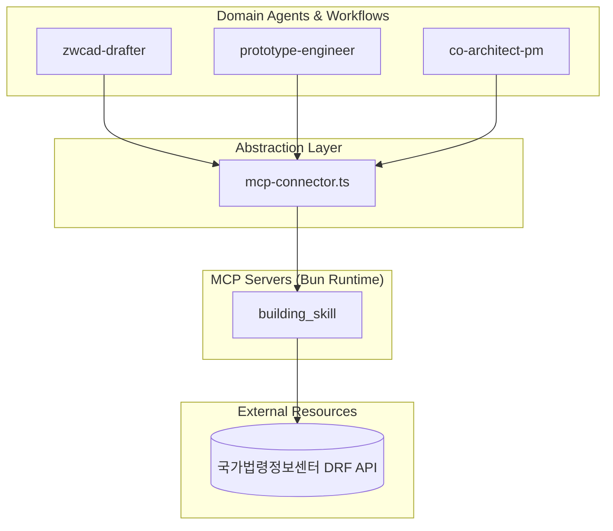

# Korean Legal MCP Integration Guide

This guide provides technical specifications, architecture diagrams, and developer API references for integrating the Korean legal/regulatory tooling into the `co-architect` workspace: the `building_skill` MCP server for building-code compliance, and the `k-law` skill (`skills/k-law/`) for Korean statute/precedent research via the 법제처 National Law Information Center Open API.

## Architecture Overview

The integration provides one specialized MCP server for real-time building-regulation compliance analysis, communicating with workspace agents via the Model Context Protocol (Stdio transport). General statute/precedent research is handled by the `k-law` skill, which calls the 국가법령정보센터 DRF API directly.

### Primary Compliance Focus

The workspace primarily manages building compliance for **residential** and **semi-residential** spaces:
*   **Residential Spaces**: Primarily Apartments (아파트/공동주택), with a focus on fire safety, evacuation paths, and shared corridor design.
*   **Semi-Residential Spaces**: Primarily Officetels (오피스텔/준주택) under Korean building codes.
*   **Secondary/Support Facilities**: Knowledge Industry Centers (KICs, 지식산업센터) and office spaces are considered secondary or support facilities within mixed-use semi-residential zones.



---

## Directory Structure

Upon completion of the porting task, the directory structure will be scaffolding as follows:

```
co-architect/
├── docs/
│   └── mcp-integration-guide.md       # This document
├── mcp/
│   ├── building-skill/                 # Korean Building Act and zoning regulations analyzer
│   │   ├── index.ts
│   │   └── tools/ (search-building, building-act, building-controls, building-gaps)
│   └── shared/                         # Common MCP utilities
│       ├── errors.ts
│       ├── logger.ts
│       ├── rate-limiter.ts
│       ├── retry.ts
│       └── types.ts
├── scripts/
│   └── lib/
│       └── mcp-cache.ts                # API Cache Layer (Local/Redis)
└── src/
    ├── mcp_connector/
    │   └── mcp-connector.ts            # Client Abstraction Layer (authoritative)
    └── cad_intelligence/
        ├── cad_io/
        │   ├── server.py               # ZWCAD MCP Server (56 tools, stdio JSON-RPC)
        │   ├── registry.py             # Tool Registry (@register_tool decorator, ADR-010)
        │   └── com_bridge.py           # ActiveX COM automation bridge
        └── plugins/
            └── compliance.py           # Zoning compliance checker
```

---

## Tool Specifications

### 1. `k-law` skill (`skills/k-law/`)
*   **Purpose**: Korean statute, precedent, administrative rule, and municipal ordinance research via the 법제처 국가법령정보센터 Open API (`lawSearch.do` / `lawService.do`). Requires the `LAW_API_OC` environment variable.
*   **Coverage**: Statute lookup, article-level retrieval, precedent (`판례`) search, administrative rules (`행정규칙`), municipal ordinances (`자치법규`), legal interpretation cases (`법령해석례`), treaties, and legal terminology.

### 2. `building_skill` MCP server
*   **Purpose**: Real-time Korean Building Act and zoning regulations analyzer.
*   **Key Tools**:
    *   `search_building_regulations`: Search building act rules by keywords.
    *   `get_building_act_requirements`: Retrieve Building Act height limits, floor area ratio (FAR), coverage, and setback regulations.
    *   `list_building_controls`: List fire safety and landscaping regulations by building occupancy type.
    *   `check_building_gaps`: Compare current building parameters against legal rules to identify non-compliant items.

---

## Client API Reference (`mcp-connector.ts`)

The connector provides typed interfaces for workspace components to interact with the legal MCP servers.

### Interface Definitions
```typescript
export interface RegulationResult {
    law_name: string;
    article_number?: string;
    article_title?: string;
    content: string;
    effective_date?: string;
    source: string;
}

export interface DrawingElement {
    id: string;
    type: string;                  // e.g., "corridor", "fire_wall", "boundary_wall"
    elevation: number;             // in meters (critical for OSHA rule matching)
    safety_controls: string[];     // safety measures extracted from drawing (e.g., ["handrail"])
    description?: string;
    width?: number;                // corridor width (in meters) - critical for Officetels/Apartments
    fire_rating?: string;          // partition fire rating (e.g., "1.0 hour")
    isDoubleLoaded?: boolean;      // corridor layout detail: double-loaded (양복도) vs. single-loaded
}

export interface BuildingDesignSpec {
    coverageRatio?: number;        // 건폐율 (%)
    floorAreaRatio?: number;       // 용적률 (%)
    height?: number;               // 높이 (m)
    setback?: number;              // 이격거리 (m)
    hasEvacuationStairs?: boolean; // 피난계단 여부
    hasFirePartition?: boolean;    // 방화구획 여부
    corridorWidth?: number;        // 복도 유효너비 (m) - critical for compliance checks
    isDoubleLoaded?: boolean;      // 복도 형태 (양복도 여부) - critical for compliance checks
}

export interface BuildingComplianceGapResult {
    parameter: string;
    designValue: string;
    requiredLimit: string;
    status: 'COMPLIANT' | 'NON_COMPLIANT' | 'WARNING' | 'UNABLE_TO_VERIFY';
    message: string;
}

export interface BuildingComplianceResult {
    zoneType: string;
    occupancyType: string;
    isOverallCompliant: boolean;
    checkedCount: number;
    nonCompliantCount: number;
    gaps: BuildingComplianceGapResult[];
    regulatorySource: {
        zoningSource: string;
        safetySource: string;
    };
}

export interface SemanticGapResult {
    element_id: string;
    element_type: string;
    applicable_regulation: {
        law_name: string;
        article_number: string;
        article_title: string;
        rule_content: string;
    };
    semantic_similarity: number;   // 0.0 to 1.0
    gap_found: boolean;
    analysis_reasoning: string;    // LLM's explanation of findings
    recommended_mitigation: string;// Recommended fixes (e.g., "Increase corridor width to 1.5m")
    risk_level: 'critical' | 'major' | 'minor';
}

export interface SemanticAnalysisConfig {
    provider?: 'gemini' | 'openai' | 'anthropic';
    model?: string;
    temperature?: number;
    strict_mode?: boolean;
}
```

### Exposed Methods
*   `verifyLegalBasis(legalBasis: string): Promise<{ valid: boolean; law_name: string; article?: string; note?: string }>`
*   `semanticGapAnalysis(elements: DrawingElement[], config?: SemanticAnalysisConfig): Promise<SemanticGapResult[]>`
*   `checkBuildingCompliance(zoneType: string, occupancyType: string, designSpec: BuildingDesignSpec): Promise<BuildingComplianceResult>`

---

## Configuration & Environment Setup

### 1. `.mcp.json` Registration
Add the following entries to `.mcp.json` in the workspace root to register the servers:
```json
{
  "mcpServers": {
    "building_skill": {
      "command": "bun",
      "args": ["run", "--env-file", ".env", "./mcp/building-skill/index.ts"],
      "env": {}
    },
    "zwcad-mcp": {
      "command": ".venv/Scripts/python.exe",
      "args": ["-u", "./src/cad_intelligence/cad_io/server.py"],
      "env": { "PYTHONPATH": "./src" }
    }
  }
}
```

### 2. Environment Variables (`.env`)
Specify the configuration flags required for correct API routing:
```ini
# National Law Information Center API Key (Contact PM to request a registered key)
LAW_API_OC=test

# Toggle mock fallback data (true for offline/testing, false for live API)
MOCK_API=true

# Cache configuration
USE_REDIS=false
```

---

## Windows & Cross-Platform Compatibility Guidelines

1.  **Shell and Path Executions**:
    Always avoid raw string manipulation of file paths. Windows shell uses backslashes (`\`) which corrupt Unix commands.
    Convert paths using normalized slash functions:
    ```typescript
    const normalizedPath = path.resolve(targetDir).replace(/\\/g, '/');
    ```
2.  **Unicode Encoding**:
    Ensure the Windows console utilizes code page `65001` (UTF-8) before executing script run commands. In powershell:
    ```powershell
    $OutputEncoding = [Console]::OutputEncoding = [System.Text.Encoding]::UTF8;
    ```
