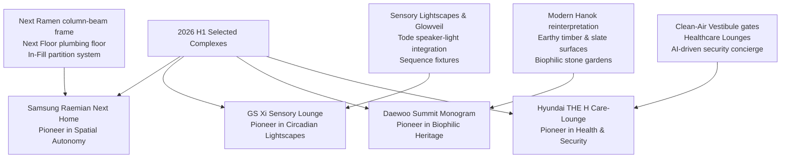
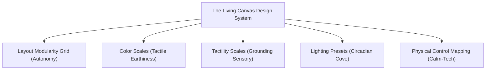

# 2026 H1 Apartment Design Trends & Design System Architecture Report

This report presents the unified design research, comparative brand analysis, and design system architecture for 2026 H1 residential developments. Synthesizing insights from storytelling analysis and empirical UX research, it establishes a screening framework to analyze four leading apartment complexes, provides a detailed design specification comparison, and outlines the foundational Design Token Architecture for **"The Living Canvas" (생동하는 캔버스)** design system.

---

## 1. Executive Summary & Zeitgeist Analysis
The residential landscape of 2026 H1 represents a fundamental transition from **performative luxury** (surface-level prestige, sterile high-gloss aesthetics, and monumental scales) to **experiential wellness, layout autonomy, and sensory sanctuary**. 

Driven by demographic shifts (singles, DINKs, and active aging seniors) and a post-digital fatigue culture, contemporary residents demand spaces that actively care for their well-being. We identify three defining architectural and design shifts:
1. **From Outer Ostentation to Inner Sanctuary**: Luxury is defined by environmental safety—such as acoustic isolation, biophilic elements, and glare-free circadian lighting—rather than ostentatious brand plaques.
2. **From Rigid Compartments to Living Organisms**: Rigid load-bearing concrete walls are replaced by open column-beam structures and modular dry-fit partition systems, allowing spaces to adapt dynamically to residents' lifecycles.
3. **From Screen-Centric Smart Homes to Calm Digital Shadows (Calm-Tech)**: Flat wall pads and flashing digital displays are receding into natural architectural finishes, prioritizing tactile physical switches, ambient indicators, and offline privacy-first edge processing.

---

## 2. Screening Framework & Brand Selection
To identify the industry benchmarks representing these shifts, we established a screening framework based on five technical and design innovation criteria. 

### Screening Criteria
1. **Spatial & Layout Modularity**: The presence of column-beam structural frames, dry drywall partition systems, and raised utility flooring that enable post-occupancy reconfiguration.
2. **Tactile Material Quality & Finishes**: Selection of low-gloss (< 5 GU), biophilic, and high-texture materials (brushed wood, textured slate, linen, bouclé) that foster sensory recovery.
3. **Sensory & Lighting Technology**: Integration of glare-free circadian lightscapes, acoustic-lighting convergence, and low-velocity climate/air systems.
4. **Health, Safety, & Sustainability**: Presence of physical air/water filtration barriers (vestibules) and eco-friendly construction techniques (dry assembly) that reduce lifetime waste.
5. **Brand Market Representation**: High brand equity, pre-sales success in 2026 H1, and distinct targeting of the primary buyer personas (Young Singles/DINKs, Families, and Empty Nesters/Seniors).

### Selected Complexes (Pre-sold in 2026 H1)
Applying this screening framework, we selected four representative complexes that represent the peak of H1 2026 apartment innovation, each specializing in a core pillar of the Zeitgeist:



1. **Samsung Raemian Next Home**: Selected for structural and spatial innovation, presenting a fully customizable floor plan that adapts to shifting household sizes.
2. **GS Xi Sensory Lounge**: Selected for sensory lighting design, converting everyday living areas into therapeutic, hospitality-inspired environments.
3. **Daewoo Summit Monogram**: Selected for material tactility and quiet luxury, blending natural Korean heritage with restorative biophilic finishes.
4. **Hyundai THE H Care-Lounge**: Selected for wellness and active safety systems, framing the home as a secure shield against external biological and environmental stressors.

---

## 3. Design Specification Comparison Table
The table below provides a detailed design specification comparison across the four selected brand complexes:

| Design Category | Samsung Raemian Next Home | GS Xi Sensory Lounge | Daewoo Summit Monogram | Hyundai THE H Care-Lounge |
| :--- | :--- | :--- | :--- | :--- |
| **Brand Philosophy** | "Space Tailored to Life" (Adaptive Living) | "Inspiring Daily Life" (Sensory Indulgence) | "Timeless Heritage" (Quiet Luxury) | "Active Protection" (Care-Driven Living) |
| **Layout Modularity** | **Next Ramen Structure**: Column-beam frame.<br>**In-Fill System**: Modular, dry-assembly wall panels.<br>**Next Floor**: Raised floor (150mm cavity) for drainage. | **Semi-Flexible Layouts**: Multi-functional lounge divisions, sliding panels, and integrated storage dividers. | **Hanok Spatial Division**: Traditional spacing patterns, sliding lattice doors, and variable screening elements. | **Zoned Compartmentalization**: Clean-room entry vestibule, private healthcare lounges, and defined isolation zones. |
| **Finishes (Colors & Materials)** | Warm neutrals, matte terracotta, sand, beige. Low-gloss, dry-fit wood and fabric wall panels. | Premium hospitality textures. Rich linen, textured bouclé, brushed nickel, and silver metallic accents. | Raw timber, textured stone (slate, granite), low-gloss natural wood coatings, and dark charcoal clays. | Dust-repellent composites, anti-bacterial surfaces, easy-clean high-durability polymers. |
| **Lighting Systems** | Integrated digital dimming, Homnik app-connected modular light systems, smart switches. | **Sensory Lightscapes**: Circadian temperature scaling.<br>**Glowveil**: 45° recessed hidden LED coves.<br>**Sequence**: Transforming fixtures. | Diffused shadow lighting, warm ambient coves, minimal glare, *lumen form-making* casting soft shadows. | **Orientation Paths**: Dimmable night-path lighting (< 15 lux, 2200K). Motion-activated floor sweeps. |
| **Sustainability & Green Systems** | Dry-assembly modular units reduce concrete waste. Reusable interior walls. | Smart-sensor power management, energy-efficient circadian LED drivers. | Biophilic stone gardens, localized Korean flora, natural cross-ventilation, low-VOC raw woods. | **Clean-Air Vestibule**: Dust/virus air shower entrance.<br>**Active HVAC**: Active HEPA air filtration. |
| **Primary Target Audience** | DINKs, Young Singles, and remote-working professionals. | Design-conscious young professionals and creative couples. | Empty nesters, multi-generational families, and high-income seniors. | Families with children, health-conscious buyers, and multi-gen households. |

---

## 4. "The Living Canvas" (생동하는 캔버스) Design System Architecture
To translate these findings into a unified design framework, we propose **"The Living Canvas" (생동하는 캔버스)** design system. This system treats the home not as a static architectural monument, but as an active, breathing canvas that adapts to the resident's physical, sensory, and functional needs.



### Core Design Token Architecture
Below are the JSON token definitions and corresponding specifications for the core elements of "The Living Canvas":

```json
{
  "system": "The Living Canvas",
  "version": "1.0.0",
  "author": "Design Lead",
  "tokens": {
    "layout": {
      "grid": {
        "base-horizontal": { "value": "300mm", "description": "Base dimension for modular In-Fill panel widths" },
        "infill-widths": { "value": ["300mm", "600mm", "900mm", "1200mm"], "description": "Standardized panel widths for inter-brand compatibility" },
        "base-vertical": { "value": "2300mm", "description": "Standardized height for modular partition walls" },
        "raised-floor-cavity": { "value": "150mm", "description": "Floor cavity depth for gravity-independent plumbing lines" }
      },
      "ergonomics": {
        "max-panel-weight": { "value": "15kg", "description": "Maximum weight threshold for single-person DIY handling" },
        "acoustic-isolation-stc": { "value": 45, "description": "Minimum Sound Transmission Class rating for modular dry-joints" }
      }
    },
    "color": {
      "warm-clay": {
        "100": { "value": "#F9F5F0", "description": "Diffused linen/soft plaster (wall coverings)" },
        "300": { "value": "#EADFDF", "description": "Warm dry sand (modular panel base)" },
        "500": { "value": "#D5A282", "description": "Terracotta clay (living room accent)" },
        "700": { "value": "#8B6D5A", "description": "Roasted mocha (timber trims and furniture joints)" },
        "900": { "value": "#4A3B32", "description": "Dark organic soil (structural grounding bases)" }
      },
      "deep-forest": {
        "100": { "value": "#E8EFE9", "description": "Soft biophilic sage (community transition areas)" },
        "300": { "value": "#A1BCA4", "description": "Pale spring moss (interior garden backdrops)" },
        "500": { "value": "#4A7C59", "description": "Pine needle green (textile/fabric accents)" },
        "700": { "value": "#284E3A", "description": "Deep forest canopy (study/meditation walls)" },
        "900": { "value": "#12241A", "description": "Shadowed foliage (high-contrast hardware elements)" }
      },
      "shadowed-stone": {
        "100": { "value": "#F0F1F1", "description": "Diffused morning mist (bathroom ceramics)" },
        "300": { "value": "#C8CCD0", "description": "Light granite (kitchen countertop bases)" },
        "500": { "value": "#7A828A", "description": "Warm natural slate (tactile fireplace panels)" },
        "700": { "value": "#42474D", "description": "Charcoal basalt (outdoor/indoor transitional flooring)" },
        "900": { "value": "#1B1D20", "description": "Shadowed obsidian (hard hardware, light borders)" }
      },
      "diffused-amber": {
        "2200k": { "value": "#FF8C42", "description": "Sunset warmth / Night-path navigation glow" },
        "2700k": { "value": "#FFB07C", "description": "Warm incandescent / Evening relaxation preset" },
        "3000k": { "value": "#FFC8A2", "description": "Soft white / Social and dining preset" },
        "3500k": { "value": "#FFE3CC", "description": "Neutral white / Reading and reading-focus preset" },
        "4000k": { "value": "#FFFFFF", "description": "Solar noon white / High-concentration active focus" }
      }
    },
    "tactility": {
      "gloss-ceiling": { "value": "5 GU", "description": "Strict maximum gloss unit limit to prevent light glare and coldness" },
      "surface-wood": { "value": "rough-brushed", "description": "Physical texture preserving natural timber grain depth" },
      "surface-stone": { "value": "matte-split", "description": "Slip-resistant, textured split slate for grounding touch points" },
      "fabric-texture": { "value": "boucle-high", "description": "Highly tactile, acoustic-dampening soft weave texture" }
    },
    "lighting-presets": {
      "morning-focus": {
        "color-temp": "3500K-4000K",
        "intensity": "300 lux",
        "angle": "45-degree indirect wash",
        "description": "Gradual blue-spectrum increase to stimulate morning wakefulness"
      },
      "midday-active": {
        "color-temp": "4000K",
        "intensity": "500 lux",
        "angle": "Direct task + indirect ceiling wash",
        "description": "Maximum glare-free brightness for high-concentration work"
      },
      "sunset-relax": {
        "color-temp": "2700K-2200K",
        "intensity": "50 lux",
        "angle": "Low-level cove + baseboards",
        "description": "Warm, melatonin-promoting light path to prepare for sleep"
      },
      "night-path": {
        "color-temp": "2200K",
        "intensity": "< 15 lux",
        "angle": "Floor-level sweep (baseboard sweep)",
        "description": "Motion-activated orientation lights that prevent night blindness"
      }
    },
    "control": {
      "physical-first": {
        "knurl-plate": { "value": "brushed-metal-knurled", "description": "High-tactility dials for muscle memory adjustments" },
        "feedback-haptic": { "value": "35Hz-pulse", "description": "Micro-vibration response to confirm selection" },
        "feedback-audio": { "value": "< 35dBA-chime", "description": "Whisper-quiet acoustic chime for system changes" }
      },
      "calm-display": {
        "veneer-matrix": { "value": "micro-perforated-wood", "description": "LED indicator hidden behind wood veneer; fades to black after 5s" }
      },
      "privacy": {
        "camera-shutter": { "value": "mechanical-slide", "description": "Physical cover slider over optical sensors for absolute privacy" },
        "voice-processing": { "value": "offline-edge", "description": "Local speech processing within unit to guarantee data isolation" }
      }
    }
  }
}
```

---

## 5. UX Insights & Empirical FGI Integration
Designing for "The Living Canvas" requires directly addressing the critical user friction points identified in mock-up house FGIs. Our design system resolves these using targeted engineering and spatial guidelines:

### A. Overcoming Modularity Usability Barriers
FGI participants expressed significant anxiety about the physical effort required to adjust "In-Fill" walls and the risk of acoustic leaks.
*   **The Weight & Assembly Standard**: The layout grid limits individual panel sizes to prevent single components from exceeding `layout.ergonomics.max-panel-weight` (15 kg). The panels must use tool-free magnetic latches rather than screws.
*   **Acoustic Seal Integration**: To resolve the drop in Sound Transmission Class (STC) common to dry joints, modular panel edges must integrate dual-durometer compressible rubber gaskets. When the magnetic latch is engaged, the rubber seals expand against the tracks, preventing acoustic leaks and achieving the mandatory `layout.ergonomics.acoustic-isolation-stc` (45+ STC).
*   **Next Floor Leak Isolation**: Relocating bathrooms and kitchens requires running gravity-independent flexible drainage. To address plumbing anxiety, the raised floor system must include localized moisture-detection tape wired to an active safety shutoff valve. If moisture is detected, the valve immediately closes, and an indicator glows on the wall switch.

### B. Mitigating Digital Tech Fatigue (Calm-Tech)
Users reported severe fatigue from blinking smart-home screens, advertisements, and complex menu paths.
*   **Zero-Screen Default**: The design system establishes a zero-screen default for primary actions. Turning on lights, adjusting temperature, and opening blinds are controlled via physical tactile switches (`control.physical-first.knurl-plate`).
*   **Perforated Veneer Interfaces**: Information displays (such as HVAC status or package arrivals) are rendered through a `control.calm-display.veneer-matrix`—a micro-perforated wood panel that projects a soft LED dot-matrix only when a hand approaches, sleeping after 5 seconds to restore the visual serenity of the room.
*   **Offline Data Security**: To address surveillance anxiety in THE H Care-Lounge, all smart microphones are connected to an offline edge-computing processor. They process commands locally and are physically isolated from external cloud networks.

---

## 6. Phase 2 & Phase 3 Actionable Directives
This unified report serves as the baseline for the next development phases:

1. **Phase 2 (Design Review & Approval)**:
   * **Visual Spec Review**: Present the four color scales (Warm Clay, Deep Forest, Shadowed Stone, Diffused Amber) for aesthetic sign-off.
   * **Modularity Verification**: Mock up physical joints and test the STC ratings of the rubber gaskets to ensure compliance with the 45 STC requirement.
2. **Phase 3 (Design Execution)**:
   * **Component Library**: Develop CAD and 3D modeling assets based on the 300mm horizontal/2300mm vertical modular grid.
   * **Hardware Spec Sheet**: Define precise blueprints for the physical-first knurled rotary dials, micro-perforated wood interfaces, and mechanical camera shutters.
   * **Circadian LED Specifications**: Document lighting driver parameters to support smooth, step-free dimming down to 1% and precise Kelvin transitions (2200K to 4000K).

---

## References
- **2026 H1 Apartment Brand Design Trends and Storytelling Analysis**: [2026-apartment-story-analysis.md](./2026-apartment-story-analysis.md)
- **2026 H1 Apartment Design Trends: User Experience (UX) Research Report**: [2026-apartment-ux-research.md](./2026-apartment-ux-research.md)
- **Samsung C&T Next Home Specs**: Technical specifications for the Next Ramen column-beam frame, In-Fill partition systems, and Next Floor gravity-independent plumbing.
- **GS E&C Glowveil & Tode Manual**: Design standards for Glowveil 45° recessed hidden LED coves and Tode integrated speaker-light sequence fixtures.
- **Daewoo E&C Summit Monogram Space Framework**: Interior architecture and spatial division principles incorporating Modern Hanok elements, raw timber, and split slate finishes.
- **Hyundai E&C THE H Clean-Air Gate Architecture**: Technical specifications for the Clean-Air Vestibule entrance gate, active HEPA filtration, and orientation path lighting.

---
*End of Report.*
