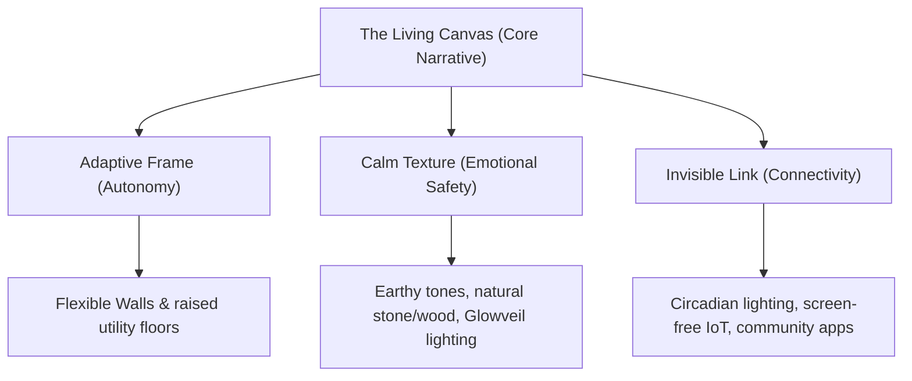

# 2026 H1 Apartment Brand Design Trends and Storytelling Analysis

This research report explores the residential design trends, marketing materials, and brand brochures of the first half of 2026. It establishes the Zeitgeist of contemporary living spaces, extracts key emotional value keywords, analyzes major brand campaigns, and provides a strategic spatial and design token framework to guide our design system.

---

## 1. Executive Summary & The 2026 Zeitgeist

The residential Zeitgeist of early 2026 represents a profound shift from **performative luxury** (flashy brand names, monumental scale, and sterile aesthetics) to **experiential wellness, flexible autonomy, and calm technology**. In a world characterized by accelerating climate consciousness, emotional isolation, and hybrid lifestyle patterns, the home has evolved from a passive shelter or financial asset into an active, protective sanctuary.

We identify three core paradigms defining early 2026 residential spaces:
1. **From Outer Ostentation to Inner Sanctuary**: Luxury is no longer defined by visible logos, but by the physical and emotional care the space provides (acoustic isolation, circadian lighting, and biophilic wellness).
2. **From Rigid Compartments to Living Organisms**: Traditional apartment layouts with static load-bearing walls are being replaced by flexible structural frames that allow layouts to shift dynamically alongside the resident's lifecycle.
3. **From Screen-Centric Smart Homes to Calm Digital Shadows**: Tech is no longer displayed on wall pads and screens; it recedes into architectural finishes ("Calm-Tech"), acting in the background without overwhelming the resident's sensory environment.

---

## 2. Core Emotional Value Keywords

Marketing materials and brochures in 2026 frequently emphasize these core emotional value keywords:

*   **Invisible Technology (Calm-Tech)**: Technology that integrates seamlessly into materials. Ambient sensors, hidden lighting, and smart climate controls operate without physical screens, preserving clean lines and reducing sensory fatigue.
*   **Biophilic Coexistence**: Designing for harmony with nature. Rather than superficial indoor plants, this refers to deep integration with organic materials (raw timber, textured stone), soft diffused natural lighting, and pocket micro-gardens that mimic natural ecosystems.
*   **Emotional Safety (Sanctuary)**: Providing sensory and psychological protection from external stressors. This is achieved through acoustic engineering, warm lighting, and grounding tactile surfaces that foster a sense of security.
*   **Lifestyle Autonomy (Fluid Living)**: Empowering homeowners to customize their space without structural constraints. The layout responds to their changing work-from-home schedules, hobbies, or multi-generational needs.

---

## 3. Apartment Brand Case Studies (H1 2026)

### A. Samsung C&T (Raemian - "Next Home" & "Homnik")
*   **Core Philosophy**: "Space Tailored to Life" — a home that changes as the family structure and individual lifecycles evolve.
*   **Key Design & Technical Enablers**:
    *   *Next Ramen Structure*: A column-and-beam frame structure that replaces interior load-bearing walls, creating a completely open, customizable space.
    *   *In-Fill System*: Modular, dry-assembly wall and furniture tiles that can be inserted, moved, or removed by residents like building blocks.
    *   *Next Floor*: A raised-floor dry construction method. Plumbing and electrical wiring run underneath the floorboards rather than being embedded in concrete slabs, allowing kitchens and bathrooms to be relocated anywhere.
    *   *Homnik Platform*: A unified digital ecosystem that connects physical home customization with digital concierge, community booking, and smart home control.
*   **Marketing Storytelling**: Emphasizes the liberation of the floor plan, portraying the apartment not as a fixed product, but as an ongoing service that grows with the resident.

### B. GS E&C (Xi - "eXperience Inspiration" & "Sensory Design")
*   **Core Philosophy**: "Inspiring Daily Life" — invoking emotional inspiration and sensory comfort through architectural detailing.
*   **Key Design & Technical Enablers**:
    *   *Sensory Lightscapes*: Circadian lighting systems that adjust light temperature and angles throughout the day.
    *   *Glowveil (Hidden Lighting)*: Recessed light ribbons that blend seamlessly into wall panels and ceilings, emitting a soft, glare-free glow.
    *   *Tode (Acoustic Light)*: Seamless, multi-functional ceiling units that combine premium speakers and smart lighting.
    *   *Sequence (Transformative Fixtures)*: Light structures that change form or focus depending on the time of day or activity.
*   **Marketing Storytelling**: Targets younger, design-conscious professionals, focusing on the sensory qualities of the space (sound, light, texture) to make the everyday home experience feel like a luxury boutique hotel.

### C. Daewoo E&C (Prugio Edition / Summit - "Modern Koreaness")
*   **Core Philosophy**: "Timeless Heritage and Restorative Nature" — blending modern architectural principles with traditional Korean space concepts.
*   **Key Design & Technical Enablers**:
    *   *Modern Hanok Reinterpretation*: Incorporating natural timber, stone, traditional spacing patterns, and soft diffused shadows (*lumen form-making*).
    *   *Biophilic Landscaping*: Exterior gardens that blend into indoor community spaces, featuring local Korean flora and stone gardens to cultivate a meditative atmosphere.
    *   *Summit Monogram*: A sleek, refined monogram combining "M" and "A" to symbolize a monument of personal aspiration and private achievement.
*   **Marketing Storytelling**: Focuses on heritage, healing, and silent luxury. Copy focuses on terms like *restoration*, *meditation*, and *quiet elegance*.

### D. Hyundai E&C (Hillstate / THE H - "Care-Driven Living")
*   **Core Philosophy**: "Active Protection and Trust" — establishing the home as a secure haven for health and peace of mind.
*   **Key Design & Technical Enablers**:
    *   *Clean-Air Vestibule Gates*: Entrance systems that filter dust and viruses before entering the main unit.
    *   *Healthcare Lounges*: Private medical screening pods and fitness consulting spaces in the community center.
    *   *AI-Driven Security Concierge*: Predictive security systems that monitor building safety and resident movement in the background.
*   **Marketing Storytelling**: Promotes a narrative of safety, reliability, and care-driven design that proactively protects the resident's family.

---

## 4. The Spatial & Design Token Framework

To translate these trends into our design system, we structure the analysis into three pillars:

| Pillar | Focus Area | Key 2026 Design Tokens / Enablers |
| :--- | :--- | :--- |
| **1. Layout Flexibility** | Structural & Modular Systems | Column-beam structure, dry drywall partitions, raised utility flooring, modular bathroom pods. |
| **2. Finish & Aesthetics** | Tone & Manner Tokens | Earthy color palettes (Warm sand, mocha, terracotta, dark forest green), matte metallic accents (silver, brushed nickel), tactile materials (raw wood, textured stone, bouclé, linen), diffused lighting. |
| **3. Community Integration** | Systematic Connectivity | Private work pods, tea-ceremony rooms, integrated wellness spas, centralized smart-community apps (connecting home to common facilities). |

### A. Layout Flexibility & Modularity
The 2026 apartment moves away from fixed walls. Units must support:
*   *Dynamic Zoning*: Spaces that partition for remote work during the day and open up for family gathering in the evening.
*   *Modular Components*: Moveable wardrobes and partition walls that double as storage units, easily reconfigured without damaging floors or ceilings.

### B. Tone & Manner / Finish Tokens
*   **Color Scale**: Moving away from sterile greys (#E5E5E5) to warm neutrals, clay tones, and forest greens.
*   **Texture Scale**: Contrasting smooth surfaces with high-tactility materials (rough-hewn wood, brushed concrete, raw slate) to create visual and tactile depth.
*   **Lighting Scale**: Replacing bright, direct ceiling fixtures with layered indirect light (cove lighting, low-level wall washes, dimmable floor lamps).

### C. Systematic Connectivity of Community Spaces
*   *Public-Private Blending*: Creating intermediate transition zones (e.g., private lobbies, micro-working lounges on residential floors) that bridge the privacy of the home with the public nature of the community center.
*   *Wellness Centers*: Designing common spaces around water features, landscaping, and acoustic isolation, offering places for quiet contemplation and digital detox.

---

## 5. UX Journeys & Empirical FGI Insights

Integrating user focus group interviews (FGI) and visitor feedback from mock-up houses reveals key tensions between marketing narratives and lived experiences:

1.  **The Usability of Modularity**:
    *   *Insight*: While users are highly enthusiastic about flexible "In-Fill" walls, they are skeptical of their usability. If reconfiguring a space requires calling a technician, they won't use it.
    *   *Design Directive*: Modular systems must be intuitive, featuring lightweight materials and clear mechanical joints that residents can adjust themselves.
2.  **Tech Fatigue and the Demand for Calm**:
    *   *Insight*: Residents are increasingly fatigued by screens. Wall pads that display constant notifications or complex smart home interfaces cause stress.
    *   *Design Directive*: Shift towards physical buttons with tactile feedback, automatic background sensors, and voice-assisted controls that do not require screens.
3.  **The Appeal of Warm Minimalism**:
    *   *Insight*: Visitors feel a strong emotional resonance with natural stone, warm timber, and diffused lighting. These finishes evoke feelings of *warmth*, *peace*, and *safety*, whereas cold, white-gloss finishes feel institutional.
    *   *Design Directive*: Standardize warm, earthy tones and tactile, matte finishes in the design token system.

---

## 6. Strategic Narrative Golden Thread: "The Living Canvas"

To synthesize these insights into a cohesive design story, we propose the narrative concept: **"The Living Canvas" (생동하는 캔버스)**.

*   **Core Message**: The home is not a static architectural monument; it is a living, breathing canvas that gently supports and adapts to the resident’s life.
*   **Visual Storytelling**: Highlighting the transition of light throughout the day, the tactile grain of materials, and the smooth, effortless movement of spatial partitions.
*   **Design System Application**:
    *   *Component Library*: Layout components named after canvas states (e.g., `StudioCanvas`, `FamilyCanvas`, `RestiveCanvas`).
    *   *Color & Material Tokens*: Grouping tokens under natural themes (`Warm Clay`, `Deep Forest`, `Shadowed Stone`, `Diffused Amber`).
    *   *Interaction Tokens*: Specifying soft, eased transitions (long animation curves, fade-ins) to reinforce the sense of calm.

---

## References

*   Samsung C&T Raemian Next Home Brochure (H1 2026)
*   GS E&C Xi Design Manual (H1 2026)
*   Daewoo E&C Summit Monogram Catalog (H1 2026)
*   Hyundai E&C THE H Concept Brochure (H1 2026)
