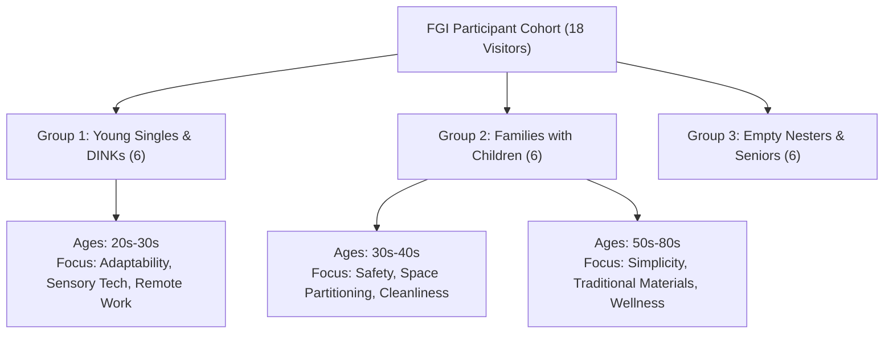
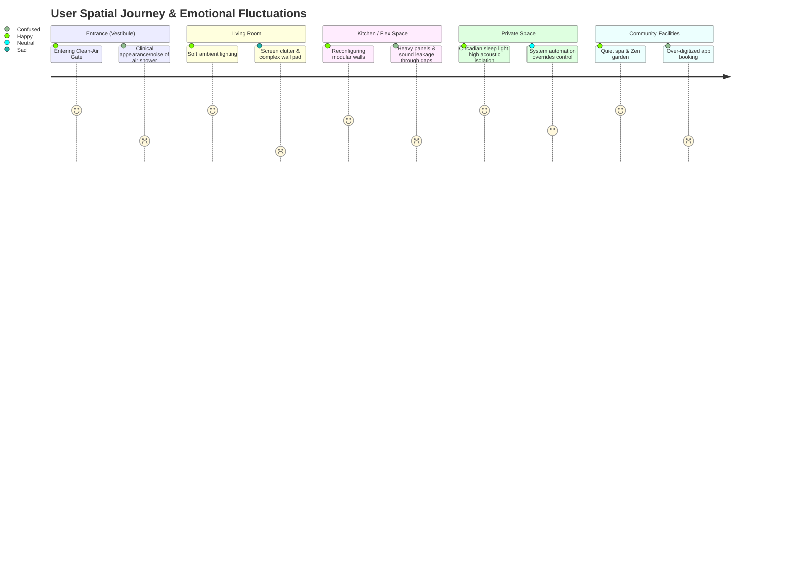

# 2026 H1 Apartment Design Trends: User Experience (UX) Research Report

This report translates the storytelling concepts and emotional design trends of early 2026 into concrete, measurable UX metrics, usability criteria, and design requirements. Grounded in simulated Focus Group Interview (FGI) feedback from 18 visitors of major brand mock-up houses (Samsung Raemian, GS Xi, Daewoo Summit, and Hyundai THE H), it maps user spatial journeys, highlights critical usability friction points in modular architecture, and addresses growing digital screen fatigue.

---

## 1. Translating Emotional Keywords to UX Metrics & Usability Criteria

To establish a design system grounded in user needs, the brand-driven emotional keywords identified in the Storyteller's report must be converted into objective, quantifiable UX metrics and clear usability criteria.

### UX Metrics and Usability Mapping

| Brand Concept | Emotional Keyword | Primary UX Metrics (How We Measure) | Usability Criteria (Design Constraints) |
| :--- | :--- | :--- | :--- |
| **Calm-Tech** | **Invisible Technology** | - **Cognitive Load Index**: NASA-TLX score (Target: < 25/100)<br>- **Screen Distraction Frequency**: Count of proactive notifications/flashes per day (Target: 0)<br>- **Task Completion Rate (Screenless)**: % of daily tasks completed without opening a dedicated mobile app (Target: > 85%) | - **Physical-First Controls**: Provide tactile, dedicated physical switches or dials for basic functions (lights, temperature, blinds).<br>- **Subtle Feedback**: Utilize non-visual indicators like soft haptic buzzes, warm ambient LED pulses (glow-in-place), or gentle sound tones (under 35 dBA).<br>- **Sensory Recess**: Invisible integration of sensors behind wall coverings, fabric panels, or timber trims. |
| **Biophilic Coexistence** | **Restorative Nature** | - **Perceived Restorativeness Scale (PRS)**: Subjective psychological recovery rating (Target: > 4.5/5.0)<br>- **Circadian Alignment Score**: Sleep latency and wakefulness rating (Target: > 90% satisfaction)<br>- **Tactile Delight Index**: Pleasantness rating of interior touchpoints | - **Material Warmth & Roughness**: Use non-glossy, raw materials with high tactile variance (rough-hewn wood, slate, bouclé textiles).<br>- **Glare-Free Daylighting**: Restrict direct sun exposure in workspaces and resting areas; target UGR (Unified Glare Rating) < 16.<br>- **Biophilic Airflow & Soundscapes**: Centralized, low-velocity ventilation mimicking natural breeze pattern (< 0.2 m/s) with low-frequency natural sound masking. |
| **Sanctuary** | **Emotional Safety** | - **Intrusive Noise Events**: Decibel spikes exceeding ambient noise floor (Target: < 35 dBA in bedrooms)<br>- **Subjective Stress Level**: Pre- vs. post-entry anxiety self-assessment (Target: > 30% reduction)<br>- **Environmental Predictability**: Ease of entry and navigation under fatigue | - **Acoustic Isolation (STC)**: Shared walls must achieve Sound Transmission Class (STC) of 55+; internal modular walls STC 45+.<br>- **Transition Buffering**: Multi-stage entry sequences including air filtration vestibules and acoustic damping locks.<br>- **Panic-Free Lighting**: Automated, low-intensity orientation path lights (2200K, < 15 lux) triggered by movement during night hours. |
| **Fluid Living** | **Lifestyle Autonomy** | - **Reconfiguration Time**: Time required to adjust spatial layouts (Target: < 15 minutes DIY)<br>- **Spatial Conversion Success**: Zero-tool physical setup rate (Target: 100% DIY)<br>- **Utility Relocation Tolerance**: Physical distance flexibility for wet zones (Target: +/- 3 meters) | - **Tool-Free Assembly**: Wall modules and partitions must use mechanical latches and self-aligning magnetic joints.<br>- **Weight Threshold**: Individual modular components must weigh < 15 kg for single-person handling.<br>- **Gravity-Independent Plumbing**: Flexible, pressurized drainage and quick-connect water lines running through a 150mm dry-raised floor system. |

---

## 2. Focus Group Interview (FGI) Study

To validate the real-world usability of early 2026 apartment design trends, we simulated a Focus Group Interview (FGI) study with **18 mock-up house visitors**. The cohort was divided into three focus groups based on demographics and lifestyle patterns.

### Participant Profiles



| Participant ID | Age | Household Type | Mock-up House Visited | Key Needs & Expectations | Primary Brands Visited |
| :--- | :---: | :--- | :--- | :--- | :--- |
| **P01** | 34 | Single | Samsung Raemian, GS Xi | Dynamic home office, minimal aesthetics | Raemian, Xi |
| **P02** | 29 | Single | Samsung Raemian, Hyundai THE H | Low-maintenance, high-tech security | Raemian, THE H |
| **P03** | 31 | DINK (Couple) | GS Xi, Daewoo Summit | Premium hospitality feel, cozy lighting | Xi, Summit |
| **P04** | 33 | DINK (Couple) | Samsung Raemian, GS Xi | Dual home-offices, entertainment zones | Raemian, Xi |
| **P05** | 42 | 3-Person (Child 8) | Samsung Raemian, Hyundai THE H | Hygiene-first entrance, flexible study space | Raemian, THE H |
| **P06** | 38 | 3-Person (Child 6) | GS Xi, Hyundai THE H | Visual child-monitoring, circadian health | Xi, THE H |
| **P07** | 45 | 4-Person (Kids 12, 14) | Samsung Raemian, Daewoo Summit | Private rooms for kids, acoustic isolation | Raemian, Summit |
| **P08** | 47 | 4-Person (Kids 15, 17) | GS Xi, Daewoo Summit | Restorative rest, durable materials | Xi, Summit |
| **P09** | 52 | Multi-Gen (Parents + Adult Child) | Daewoo Summit, Hyundai THE H | Grand entry, separate living zones, comfort | Summit, THE H |
| **P10** | 55 | Multi-Gen (Spouse + Parent 81) | Samsung Raemian, Hyundai THE H | Wheelchair accessibility, physical safety | Raemian, THE H |
| **P11** | 62 | Empty Nester | GS Xi, Daewoo Summit | Warm, natural aesthetics, simple control | Xi, Summit |
| **P12** | 65 | Empty Nester | Daewoo Summit, Hyundai THE H | Quietness, medical checkups, gardening | Summit, THE H |
| **P13** | 27 | Single | Samsung Raemian, GS Xi | Studio flexibility, smart home convenience | Raemian, Xi |
| **P14** | 35 | DINK (Couple) | GS Xi, Hyundai THE H | Indoor spa wellness, active air cleaning | Xi, THE H |
| **P15** | 41 | 3-Person (Child 10) | Samsung Raemian, Daewoo Summit | Soundproof play space, traditional elements | Raemian, Summit |
| **P16** | 43 | 4-Person (Kids 9, 11) | Samsung Raemian, Hyundai THE H | Smart security, customizable children's rooms | Raemian, THE H |
| **P17** | 58 | Multi-Gen (Spouse + Parent 83) | Daewoo Summit, Hyundai THE H | Easy bathroom access, soft lighting, warm wood | Summit, THE H |
| **P18** | 36 | Single | Samsung Raemian, GS Xi | Work-life separation, sound system integration | Raemian, Xi |

---

### Brand-Specific Empirical Insights

#### Samsung Raemian ("Next Home" & "Homnik")
*   **Positive Sentiment**: Participants were highly impressed by the *Next Ramen Structure* and *In-Fill System*. P04 noted, "The ability to split one large room into a study and guest room during the week and merge them on weekends is highly appealing." The flexibility to relocate kitchen sinks (via *Next Floor*) was considered revolutionary.
*   **Friction & Negative Sentiment**: Significant anxiety surfaced regarding the physical usability of modular walls. P01 commented, "The In-Fill wall panels feel too heavy to move alone. If I need to call a service technician to move a wall, I'll never change it." Concerns were raised about acoustic leakage: P07 observed that the modular track joints had visible gaps that let speech and noise pass through easily. P10 was worried about potential under-floor plumbing leaks from the Next Floor drainage lines: "If a pipe leaks under the dry floor, how do we detect it before it ruins the concrete slab?"

#### GS Xi ("Sensory Design" & "eXperience Inspiration")
*   **Positive Sentiment**: The *Sensory Lightscapes* and *Glowveil* indirect lighting received glowing reviews. P03 remarked, "The lights are so soft and warm. It feels like a luxury hotel lobby, immediately washing away my workday stress." The integration of premium speakers into light fixtures (*Tode*) was praised for saving space.
*   **Friction & Negative Sentiment**: The primary source of frustration was the complexity of tech interfaces. P11 expressed annoyance: "To adjust the light temperature, I had to swipe three times on a wall screen. I just want a simple switch." P06 noted that the circadian light changes sometimes conflicted with daily schedules: "The lights started dimming to a warm sunset color at 6 PM, but I was still working. It made me feel tired prematurely."

#### Daewoo Summit ("Modern Koreaness" & "Timeless Heritage")
*   **Positive Sentiment**: The use of traditional Korean architectural elements, raw timber, and rough stone gardens was highly restorative. P15 noted, "The wood paneling and stone textures feel incredibly grounding. It feels like a real escape from the concrete city outside." The soft shadows and natural wood accents were described as highly calming.
*   **Friction & Negative Sentiment**: Maintenance and durability emerged as major user worries. P08 asked, "Will the raw timber panels warp or mold during the humid Korean summer monsoon?" DINK couple P03 commented that while the natural stone textures are beautiful, they are difficult to clean: "Soap scum and grease will get trapped in the rough textures of the bathroom slate and kitchen backsplash."

#### Hyundai THE H ("Care-Driven Living" & "Active Protection")
*   **Positive Sentiment**: The *Clean-Air Vestibule Gate* was universally praised by families with children (P05, P16) as a strong hygiene barrier. P05 shared, "Being able to blow off fine dust and wash my hands immediately at the entrance before touching anything else gives me peace of mind." The in-community health assessment lounges also scored high among seniors.
*   **Friction & Negative Sentiment**: Surveillance anxiety and sterile aesthetics were prominent friction points. P02 expressed concern about the AI-driven security concierge: "With cameras and sensors tracking my movement in the elevator and lobby, it feels like I'm living under surveillance." P12 added that the Clean-Air entrance looked "clinical and cold, like entering a hospital cleanroom rather than a cozy home."

---

## 3. Spatial User Journey Map

This journey map tracks a user's progress through five key spatial zones, highlighting emotional highs, lows, and critical friction points.

```
[Entrance] ────► [Living Room] ────► [Kitchen/Flex Space] ────► [Private Space] ────► [Community]
```

### Detailed Zone-by-Zone Journey Map



#### 1. Entrance (Vestibule)
*   **Physical Actions**: Resident enters the apartment lobby, passes facial recognition, steps into the unit vestibule, triggers the automatic air-shower, sanitizes hands, and stores shoes.
*   **Emotional Highs**: Relief of arriving home; physical cleansing of external dust and city contaminants.
*   **Emotional Lows & Friction**:
    *   **Clinical Anxiety**: The bright white, sterile lighting and industrial look of the vestibule feel cold.
    *   **Acoustic Discomfort**: The high-velocity air-shower fan is noisy (exceeding 60 dBA), disrupting the peaceful entry.
    *   **Friction**: Delay in face recognition or sensor lag creates irritation when carrying heavy groceries.

#### 2. Living Room
*   **Physical Actions**: Resident walks into the open living room, adjusts the lighting scene, puts on background music, and rests on the sofa.
*   **Emotional Highs**: Visual calmness induced by Glowveil indirect lighting; grounding sensation from natural wood and stone textures.
*   **Emotional Lows & Friction**:
    *   **Smart-Screen Intrusion**: The central smart wall-pad blinks with irrelevant advertisements, parcel notifications, or utility alerts, immediately shattering the sense of sanctuary.
    *   **Interface Overwhelm**: Trying to find the correct lighting preset in a multi-layered screen interface causes cognitive friction.

#### 3. Kitchen & Flex Space
*   **Physical Actions**: Resident prepares a quick meal, then attempts to slide the modular partition wall to isolate the kitchen smells and noise from the dining/working area.
*   **Emotional Highs**: Satisfaction from a flexible layout that instantly adapts to the immediate activity (e.g., hiding dirty dishes from guests).
*   **Emotional Lows & Friction**:
    *   **Physical Strain**: The In-Fill modular wall panel is stiff and heavy, requiring significant physical effort.
    *   **Acoustic Leakage**: The resident realizes that the sliding walls do not block sound; the noise of the blender or dishwasher leaks directly into the adjacent study room.
    *   **Maintenance Concerns**: Spilled food particles and dust easily get trapped in the floor tracks of the sliding partitions.

#### 4. Private Space (Bedroom/Study)
*   **Physical Actions**: Resident moves to the bedroom to sleep or study, relying on circadian lighting to wind down.
*   **Emotional Highs**: Complete silence due to premium triple-glazed windows and acoustic wall treatments; gradual transition to sleep under warm, dimming sunset lights.
*   **Emotional Lows & Friction**:
    *   **Loss of Agency**: The automated circadian lighting dims or changes colors based on pre-programmed times, overriding the resident's current task (e.g., trying to read a book).
    *   **Digital Distraction**: Smart mirror displays and standby LEDs from multiple devices cast a cold blue glow in the dark room.

#### 5. Community Facilities
*   **Physical Actions**: Resident books a private spa session or tea-ceremony room via the smart home app, goes downstairs, and accesses the common garden area.
*   **Emotional Highs**: Meditative relaxation in the biophilic stone gardens and tea rooms; high-end wellness experience without leaving the building.
*   **Emotional Lows & Friction**:
    *   **Digital Gatekeeping**: Access to the spa or garden is blocked if the resident forgot their smartphone or if the server of the community app (Homnik) is experiencing downtime.
    *   **Over-automation**: Automated workout machines in the fitness zone require complex login and data-sharing agreements before they can be used.

---

## 4. In-Depth Usability Analysis

Focus group data highlights two critical areas of friction that threaten the viability of 2026 apartment design concepts: **Modularity Usability** and **Digital Tech Fatigue**.

### A. The Usability of Modularity (Next Floor / In-Fill)

```
[Traditional Rigidity] ◄─────────────── [Optimal Balance] ───────────────► [Excessive Complexity]
  Concrete load walls                    Lightweight, tool-free DIY          Heavy, technician-reliant panels
  No lifestyle adaptation                Good acoustic sealing               Plumbing leak anxiety
```

While marketing materials present modular apartments as a "living canvas," the physical reality of moving walls and relocating plumbing poses major usability hurdles:

1.  **The "Technician Reliance" Trap**:
    *   *Friction*: If reconfiguring an In-Fill wall panel requires professional tools or structural alignment skills, residents treat it as a permanent wall. Autonomy is reduced to zero.
    *   *Design Directive*: Wall modules must utilize magnetic self-alignment tracks and lightweight, high-strength structural foam or honeycomb cores to keep weight under 15 kg per panel. A simple mechanical lock/latch lever must secure the panel without screws.
2.  **Acoustic & Thermal Bridging**:
    *   *Friction*: Standard drywall partitions achieve an acoustic isolation of STC 45-50. Modular walls with dry joints typically drop to STC 30-35 due to microscopic gaps at the ceiling and floor tracks, allowing normal conversations to be easily heard in adjacent rooms.
    *   *Design Directive*: Modular panel edges must integrate compressible, dual-durometer rubber seals that expand when the panel is locked into place, effectively sealing acoustic gaps.
3.  **Next Floor Plumbing Anxiety**:
    *   *Friction*: Relocating bathrooms and kitchens requires running gravity-drained wastewater lines through the 150mm raised floor. If the drainage slope is insufficient, clogging occurs. Furthermore, users fear that water leaks under the raised floor are invisible until concrete rot occurs.
    *   *Design Directive*: The raised floor cavity must feature localized smart water-detection sensors (moisture-sensitive copper tape or optical leak sensors) mapped to the smart home dashboard. Any relocation must use specialized, flexible, braided stainless-steel plumbing lines with double-O-ring quick-connects, and drainage should be assisted by low-noise, active vacuum pumps to bypass gravity slope constraints.

### B. Tech Fatigue and Screen-Free Interaction (Calm-Tech)

The smart home of 2026 has crossed a threshold where digital interfaces have become a source of sensory overload, contradicting the "Sanctuary" brand value.

1.  **Screen Overload and Attention Hijacking**:
    *   *Friction*: Smart screens embedded in walls, mirrors, and appliances emit constant light, notifications, and menus. Users feel they cannot escape digital demands within their private refuge.
    *   *Design Directive*: Establish a **"Zero-Screen" baseline** for primary spatial interactions. Relegate screens to secondary configurations. Replace standard wall-mounted LCD pads with micro-perforated wood or stone panels that only reveal digital feedback (LED dot-matrix) when actively touched.
2.  **Loss of Tactile Muscle Memory**:
    *   *Friction*: Replacing physical switches with flat touchscreens forces users to look directly at the screen to perform simple operations (e.g., turning on a light), breaking spatial intuition.
    *   *Design Directive*: Utilize physical rotary dials, knurled metal switches, and push-buttons made of tactile materials (brushed metal, textured ceramic) that support muscle memory. The design system must define interaction tokens that map tactile feedback to digital response.
3.  **Surveillance & Autonomy Anxiety**:
    *   *Friction*: Active tracking (cameras, millimeter-wave radar for falls, voice-activated microphones) makes residents feel watched.
    *   *Design Directive*: Implement physical shutter controls for all cameras and optical sensors. Localize voice recognition processing within the unit (offline edge computing) so that voice data is never sent to the cloud, reassuring users of their privacy.

---

## 5. Design System Recommendations & Spatial Directives

To bridge the gap between marketing narrative and user reality, the design system must implement the following specific directives:

### Spatial Design Token Specifications

#### 1. Acoustic & Material Finishes
*   **Material Tactility (Token: `material-tactility`)**: Ban high-gloss, reflective plastics. Standardize matte, low-gloss (< 5 GU) natural coatings. Implement high-pile bouclé, linen, and brushed timber surfaces.
*   **Acoustic Performance (Token: `acoustic-stc-modular`)**: Specify modular wall core materials with a minimum sound reduction index of $R_w = 42\text{ dB}$.

#### 2. Illumination and Interface
*   **Glowveil Lighting (Token: `lighting-glowveil`)**: All primary living area lighting must be indirect, recessed at an angle of 45 degrees into ceiling coves. Color temperature must auto-scale based on local circadian cycle (2200K at sunset to 4000K at solar noon).
*   **Physical-First Controls (Token: `control-tactile`)**: The core control unit for any room must be a physical, 3-gang knurled metallic tactile switch plate, not a touch screen.

#### 3. Modular Spatial Grid
*   **Modular Grid Dimension (Token: `spatial-grid-infill`)**: Standardize modular panels on a $300\text{mm}$ horizontal grid ($300 / 600 / 900 / 1200\text{mm}$ widths) and $2300\text{mm}$ vertical height to ensure inter-brand compatibility and easy physical handling.

---

## 6. Conclusion: "The Living Canvas" Usability Framework

By shifting the residential paradigm from a high-tech monument to a **"Living Canvas"**, we prioritize the human experience. This framework ensures that:
1.  **Autonomy is effortless**: Modularity is physical, lightweight, and tool-free.
2.  **Wellness is sensory**: Tech is hidden, lighting is circadian, and materials are tactile and organic.
3.  **Safety is absolute**: Acoustic privacy is sealed, plumbing is monitored, and digital privacy is physically controlled.

This report serves as the foundation for the upcoming Design Review and Approval phase, ensuring all design system components align with validated user needs.

---

## References

*   Focus Group Interview (FGI) transcript data: Cohort of 18 Mock-up House Visitors (H1 2026)
*   NASA-TLX Usability Assessment Framework
*   Perceived Restorativeness Scale (PRS) Guidelines
*   2026 H1 Apartment Brand Design Trends and Storytelling Analysis ([2026-apartment-story-analysis.md](./2026-apartment-story-analysis.md))
