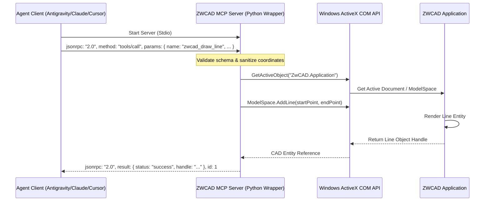
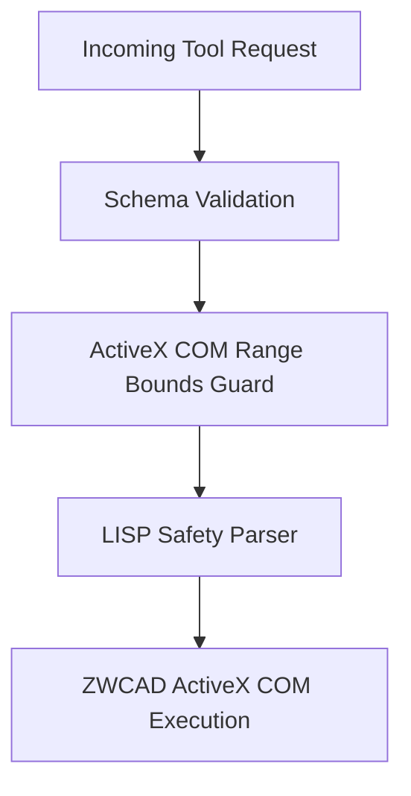

# MCP-000: Architecture & Integration Plan: ZWCAD MCP Server

> **Superseded by ADR-010** for tool registration architecture.
> This document remains the authoritative reference for MCP JSON-RPC 2.0 protocol implementation.

> **Spec ID**: MCP-000
> **Version**: 1.0 (historical retrofit, 2026-07-04)
> **Status**: Historical — implemented, superseded in part by AXIS-001/ELEV-002 (original ~10-tool scope now 50 tools live in the MCP server)
> **Created**: (predates spec-ID convention; retroactively assigned 2026-07-04 per DOCS-001)

---

This document outlines the technical design, architectural specifications, and implementation roadmap for the Model Context Protocol (MCP) Server for ZWCAD. This server establishes a standardized, secure, and bidirectional communication channel between ZWCAD and LLM-based agent systems (e.g., Antigravity, Claude Code, Cursor, Codex).

---

## 1. Executive Summary & Purpose

Historically, programmatically automating or querying computer-aided design (CAD) drawings in ZWCAD from external agentic systems has required building custom HTTP/REST APIs, WebSockets, or proprietary plugins. These approaches create substantial friction, including network exposure, complex state management, and manual tool mapping for each new model or agent.

### Why Standardized MCP Over Custom HTTP API?
Using the Model Context Protocol (MCP) standard over custom HTTP APIs offers critical advantages:

1. **Native Client Support**: Modern agent hosts (Antigravity, Claude Desktop, Cursor) support the MCP standard out of the box. No custom orchestration layer needs to be developed on the agent client side.
2. **Zero Network Configuration (Stdio)**: By utilizing standard input/output (stdio) as the transport layer, the server does not bind to TCP/UDP ports. This eliminates firewall blocks, port exhaustion, and local network vulnerability vectors.
3. **Self-Documenting Tool Discovery**: The MCP protocol specifies a `tools/list` capability. The agent client automatically fetches schemas, types, and descriptions, permitting dynamic capability negotiation.
4. **Reliable Tool Invocation**: Tool requests and responses are strictly formatted as JSON-RPC 2.0 messages, ensuring robust serialization and error propagation.

### Benefits of Cross-Agent Integration
A standardized ZWCAD MCP server creates a uniform interface that benefits all agent platforms within the workspace ecosystem:
* **Antigravity**: Seamlessly routes mass study, drafting, and design validation tasks to the ZWCAD MCP server using local agent execution pipelines.
* **Claude Code**: Integrates CAD geometry creation directly into command-line workflows and scripts.
* **Cursor / VS Code**: Allows developers to generate CAD elements, query active selections, or automate layouts directly from their coding workspace.
* **Codex**: Simplifies the generation of complex architectural patterns from plain-text instructions.

---

## 2. Proposed Architecture

The ZWCAD MCP Server operates as a bridge between the agent client (JSON-RPC stdio) and the ZWCAD desktop application (ActiveX COM API).

### Communication Flow
1. **Agent Client** spawns the MCP Server as a background process and communicates via `stdin` and `stdout`.
2. **MCP Server** processes incoming JSON-RPC 2.0 messages, parses tool invocations, and validates arguments against the tool's JSON Schema.
3. **ActiveX Bridge** translates valid requests into COM Automation calls to the running ZWCAD application.
4. **ZWCAD Engine** executes the requested drawing operations or retrieves database geometry, returning results back through COM.
5. **MCP Server** wraps the results in a JSON-RPC response and writes to `stdout`.

### System Sequence Diagram



### Key Architectural Components
* **Stdio Protocol Wrapper**: A lightweight Python implementation using standard libraries to handle JSON-RPC message framing and buffering.
* **COM Dispatcher**: Connects to the running ZWCAD process via the `ZwCAD.Application` COM interface (typically `ZwCAD.Application.2026` or matching versions) using `pywin32` or `comtypes`.
* **Geometry Engine Translator**: Converts standard JSON-based geometric objects (e.g., coordinates, arrays, boundaries) into the format required by the CAD ActiveX COM layer (double-precision arrays).

### 2.1. ZWCAD Connection and Launch Lifecycle (Milestone 1)
To handle scenarios where ZWCAD is not currently running or the COM interface is temporarily unresponsive due to initialization lag, the MCP Server implements an automated startup and retry lifecycle:
1. **Process Detection**: The server checks for an active `zwcad.exe` process using standard Windows utilities (e.g., `tasklist` via `subprocess`).
2. **Automated Launch Wrapper**: If no active process is found, the server attempts to launch `zwcad.exe` using the path defined in the `ZWCAD_PATH` environment variable (falling back to standard registry-derived install paths if not defined). The process is launched in the background via `os.startfile` or `subprocess.Popen`.
3. **Initialization Polling & Backoff**: Once launched, the server enters a polling loop (checking COM availability every 1 second, up to 5 times) using `win32com.client.GetActiveObject` to wait for the ActiveX interface to become active.
4. **COM Exception Retry Loop**: ZWCAD's COM interface can throw RPC busy errors (e.g., `0x8001010A (RPC_E_SERVERCALL_RETRYLATER)`) during initialization or under heavy loads. The server handles this by catching `pywintypes.com_error` exceptions and retrying with exponential backoff before failing the stdio connection.

---

## 3. MCP Tools Specification

The following specifications define the primary tools exposed by the ZWCAD MCP Server. All coordinates are defined in the World Coordinate System (WCS).

### 3.1. `zwcad_draw_line`
Creates a line segment between two 3D coordinates.

* **Schema Definition**:
```json
{
  "name": "zwcad_draw_line",
  "description": "Draws a straight line segment in the active drawing document. Assigns the layer directly to the entity instead of changing the global active layer state. If the target layer does not exist, it is automatically created.",
  "inputSchema": {
    "type": "object",
    "properties": {
      "start_point": {
        "type": "array",
        "description": "Start point coordinate [X, Y, Z]. Each value must be within the boundary range of [-1000000000.0, 1000000000.0].",
        "items": {
          "type": "number",
          "minimum": -1000000000.0,
          "maximum": 1000000000.0
        },
        "minItems": 3,
        "maxItems": 3
      },
      "end_point": {
        "type": "array",
        "description": "End point coordinate [X, Y, Z]. Each value must be within the boundary range of [-1000000000.0, 1000000000.0].",
        "items": {
          "type": "number",
          "minimum": -1000000000.0,
          "maximum": 1000000000.0
        },
        "minItems": 3,
        "maxItems": 3
      },
      "layer": {
        "type": "string",
        "description": "Target layer name. If layer does not exist, it is created automatically. If omitted, uses active layer."
      },
      "color": {
        "type": "integer",
        "description": "ZWCAD Color Index (1-255)."
      }
    },
    "required": ["start_point", "end_point"]
  }
}
```

### 3.2. `zwcad_draw_polyline`
Draws a 2D polyline from an array of vertices.

* **Schema Definition**:
```json
{
  "name": "zwcad_draw_polyline",
  "description": "Draws a 2D polyline in the active drawing document. Assigns the layer directly to the entity instead of changing the global active layer state. If the target layer does not exist, it is automatically created.",
  "inputSchema": {
    "type": "object",
    "properties": {
      "vertices": {
        "type": "array",
        "description": "Flat list of X and Y coordinates: [x1, y1, x2, y2, ...]. Each value must be within the boundary range of [-1000000000.0, 1000000000.0].",
        "items": {
          "type": "number",
          "minimum": -1000000000.0,
          "maximum": 1000000000.0
        },
        "minItems": 4
      },
      "closed": {
        "type": "boolean",
        "description": "Specifies whether the polyline is closed.",
        "default": false
      },
      "layer": {
        "type": "string",
        "description": "Target layer name. If layer does not exist, it is created automatically. If omitted, uses active layer."
      }
    },
    "required": ["vertices"]
  }
}
```

### 3.3. `zwcad_draw_text`
Inserts single-line text (DTEXT/MTEXT equivalent) at a specific coordinate.

* **Schema Definition**:
```json
{
  "name": "zwcad_draw_text",
  "description": "Creates a text object in the active drawing document. Assigns the layer directly to the entity instead of changing the global active layer state. If the target layer does not exist, it is automatically created.",
  "inputSchema": {
    "type": "object",
    "properties": {
      "text": {
        "type": "string",
        "description": "The text string to be inserted."
      },
      "insertion_point": {
        "type": "array",
        "description": "Insertion coordinate [X, Y, Z]. Each value must be within the boundary range of [-1000000000.0, 1000000000.0].",
        "items": {
          "type": "number",
          "minimum": -1000000000.0,
          "maximum": 1000000000.0
        },
        "minItems": 3,
        "maxItems": 3
      },
      "height": {
        "type": "number",
        "description": "Text height in drawing units (minimum 0.001).",
        "minimum": 0.001
      },
      "rotation": {
        "type": "number",
        "description": "Rotation angle in degrees.",
        "default": 0.0
      },
      "layer": {
        "type": "string",
        "description": "Target layer name. If layer does not exist, it is created automatically. If omitted, uses active layer."
      }
    },
    "required": ["text", "insertion_point", "height"]
  }
}
```

### 3.4. `zwcad_draw_circle`
Draws a circle at a given center coordinate and radius.

* **Schema Definition**:
```json
{
  "name": "zwcad_draw_circle",
  "description": "Draws a circle in the active drawing document. Assigns the layer directly to the entity instead of changing the global active layer state. If the target layer does not exist, it is automatically created.",
  "inputSchema": {
    "type": "object",
    "properties": {
      "center": {
        "type": "array",
        "description": "Center coordinate [X, Y, Z]. Each value must be within the boundary range of [-1000000000.0, 1000000000.0].",
        "items": {
          "type": "number",
          "minimum": -1000000000.0,
          "maximum": 1000000000.0
        },
        "minItems": 3,
        "maxItems": 3
      },
      "radius": {
        "type": "number",
        "description": "Circle radius (must be positive).",
        "minimum": 0.0,
        "exclusiveMinimum": true
      },
      "layer": {
        "type": "string",
        "description": "Target layer name. If layer does not exist, it is created automatically. If omitted, uses active layer."
      },
      "color": {
        "type": "integer",
        "description": "ZWCAD Color Index (1-255).",
        "minimum": 1,
        "maximum": 255
      }
    },
    "required": ["center", "radius"]
  }
}
```

### 3.5. `zwcad_draw_arc`
Draws an arc given center, radius, start angle, and end angle (in degrees).

* **Schema Definition**:
```json
{
  "name": "zwcad_draw_arc",
  "description": "Draws an arc in the active drawing document. Assigns the layer directly to the entity instead of changing the global active layer state. If the target layer does not exist, it is automatically created.",
  "inputSchema": {
    "type": "object",
    "properties": {
      "center": {
        "type": "array",
        "description": "Center coordinate [X, Y, Z]. Each value must be within the boundary range of [-1000000000.0, 1000000000.0].",
        "items": {
          "type": "number",
          "minimum": -1000000000.0,
          "maximum": 1000000000.0
        },
        "minItems": 3,
        "maxItems": 3
      },
      "radius": {
        "type": "number",
        "description": "Arc radius (must be positive).",
        "minimum": 0.0,
        "exclusiveMinimum": true
      },
      "start_angle": {
        "type": "number",
        "description": "Start angle in degrees."
      },
      "end_angle": {
        "type": "number",
        "description": "End angle in degrees."
      },
      "layer": {
        "type": "string",
        "description": "Target layer name. If layer does not exist, it is created automatically. If omitted, uses active layer."
      },
      "color": {
        "type": "integer",
        "description": "ZWCAD Color Index (1-255).",
        "minimum": 1,
        "maximum": 255
      }
    },
    "required": ["center", "radius", "start_angle", "end_angle"]
  }
}
```

### 3.6. `zwcad_apply_hatch`
Applies a hatch pattern (e.g., solid or predefined ANSI patterns) to a closed boundary object identified by its CAD entity handle.

* **Schema Definition**:
```json
{
  "name": "zwcad_apply_hatch",
  "description": "Applies a hatch pattern to a closed boundary in the active ModelSpace.",
  "inputSchema": {
    "type": "object",
    "properties": {
      "polyline_handle": {
        "type": "string",
        "description": "Handle of the closed boundary entity (e.g., polyline) to hatch."
      },
      "pattern_name": {
        "type": "string",
        "description": "Hatch pattern name (e.g. 'SOLID', 'ANSI31'). Default is 'SOLID'.",
        "default": "SOLID"
      },
      "pattern_type": {
        "type": "integer",
        "description": "Pattern type (1 for Predefined, 0 for UserDefined). Default is 1.",
        "default": 1
      },
      "associativity": {
        "type": "boolean",
        "description": "Specifies whether the hatch is associative.",
        "default": true
      },
      "layer": {
        "type": "string",
        "description": "Target layer name. If layer does not exist, it is created automatically. If omitted, uses active layer."
      },
      "color": {
        "type": "integer",
        "description": "ZWCAD Color Index (1-255).",
        "minimum": 1,
        "maximum": 255
      }
    },
    "required": ["polyline_handle"]
  }
}
```

### 3.7. `zwcad_get_active_document_info`
Retrieves structural metadata and settings of the currently loaded drawing document.

* **Schema Definition**:
```json
{
  "name": "zwcad_get_active_document_info",
  "description": "Retrieves information about the active ZWCAD document (filename, layers, database entity count).",
  "inputSchema": {
    "type": "object",
    "properties": {}
  }
}
```
* **Sample Output**:
```json
{
  "filename": "FloorPlan_L1.dwg",
  "path": "C:\\Workspace\\Projects\\co-architect\\drawings\\",
  "active_layer": "Architectural_Walls",
  "layers": ["0", "Defpoints", "Architectural_Walls", "Electrical_Fixtures"],
  "entity_count": 1420,
  "units": "Millimeters"
}
```

### 3.8. `zwcad_get_selected_geometry`
Extracts geometric data from the user's active drawing selection.

* **Schema Definition**:
```json
{
  "name": "zwcad_get_selected_geometry",
  "description": "Fetches properties and coordinates of currently selected entities in the drawing.",
  "inputSchema": {
    "type": "object",
    "properties": {}
  }
}
```
* **Sample Output**:
```json
{
  "selected_count": 2,
  "entities": [
    {
      "handle": "A4E",
      "type": "AcDbLine",
      "layer": "Architectural_Walls",
      "start_point": [100.0, 150.0, 0.0],
      "end_point": [200.0, 150.0, 0.0],
      "length": 100.0
    },
    {
      "handle": "A4F",
      "type": "AcDbText",
      "layer": "Text_Labels",
      "text": "Living Room",
      "insertion_point": [150.0, 175.0, 0.0]
    }
  ]
}
```

### 3.9. `zwcad_list_layers` (Milestone 2)
Retrieves the list of all layers in the active drawing document along with their properties.

* **Schema Definition**:
```json
{
  "name": "zwcad_list_layers",
  "description": "Retrieves the list of all layers in the active drawing document along with their properties (name, frozen, locked, color).",
  "inputSchema": {
    "type": "object",
    "properties": {}
  }
}
```
* **Sample Output**:
```json
{
  "layers": [
    {
      "name": "0",
      "frozen": false,
      "locked": false,
      "color": 7
    },
    {
      "name": "A-WALL",
      "frozen": false,
      "locked": false,
      "color": 2
    },
    {
      "name": "A-DOOR",
      "frozen": true,
      "locked": false,
      "color": 4
    },
    {
      "name": "X-REFS",
      "frozen": false,
      "locked": true,
      "color": 8
    }
  ]
}
```

### 3.10. `zwcad_set_layer_state` (Milestone 2)
Configures the state of a specific layer (freeze/thaw, lock/unlock) in the active drawing document.

* **Schema Definition**:
```json
{
  "name": "zwcad_set_layer_state",
  "description": "Configures the state of a specific layer (freeze/thaw, lock/unlock) in the active drawing document.",
  "inputSchema": {
    "type": "object",
    "properties": {
      "layer_name": {
        "type": "string",
        "description": "Name of the target layer."
      },
      "frozen": {
        "type": "boolean",
        "description": "True to freeze the layer, False to thaw it. If omitted, current frozen state is preserved."
      },
      "locked": {
        "type": "boolean",
        "description": "True to lock the layer, False to unlock it. If omitted, current locked state is preserved."
      }
    },
    "required": ["layer_name"]
  }
}
```
* **Sample Output**:
```json
{
  "status": "success",
  "layer": "A-DOOR",
  "frozen": true,
  "locked": false
}
```

### 3.11. Standardized JSON-RPC Error Codes
To ensure client applications can parse and handle exceptions programmatically, the ZWCAD MCP Server maps specific COM automation errors and drawing boundaries to a standardized range of JSON-RPC 2.0 error codes starting at `-32001`:

| Error Code | Error Title | Description & Typical Causes |
| :--- | :--- | :--- |
| **-32001** | ZWCAD Connection Failed | ZWCAD process could not be detected, or `win32com.client.GetActiveObject` failed after standard retry/launch loops. |
| **-32002** | ZWCAD COM Bridge Exception | ZWCAD COM interface returned a busy error (e.g., `RPC_E_SERVERCALL_RETRYLATER`) or another ActiveX database exception. |
| **-32003** | Limits and Boundary Violation | Tool arguments exceeded defined boundaries (e.g., coordinates outside `[-1e9, 1e9]` or text height `< 0.001`). |
| **-32004** | LISP Security Violation | The LISP script or command passed contains blocked keywords (e.g., `open`, `startapp`, `vl-registry-write`) under the security policy. |
| **-32005** | Layer Operation Exception | Attempted to modify or draw on a locked layer, or query properties of a non-existent layer that cannot be created. |

* **Sample Error Response JSON**:
```json
{
  "jsonrpc": "2.0",
  "error": {
    "code": -32001,
    "message": "ZWCAD Application connection failed. Ensure ZWCAD is running.",
    "data": {
      "details": "pywintypes.com_error: (-2147221008, 'CoInitialize has not been called.', None, None)"
    }
  },
  "id": 1
}
```

---

## 4. Cross-Platform Configuration Templates

To enable the host agents to spin up the ZWCAD MCP Server, the following configuration files must be created or updated.

### Environment Variables
ZWCAD environment variables are configured in the project root `.env` file (copy from `.env.sample`):
* `ZWCAD_PATH`: Specifies the absolute path to the ZWCAD executable (`zwcad.exe`). This is optional; if omitted, the server attempts to automatically locate ZWCAD through the registry. However, configuring this variable is highly recommended for non-standard installations or multi-version environments.
* `ZWCAD_VERSION`: Specifies the version identifier to use for the ActiveX COM registry object (e.g., `2026`).

> **Note (2026-06-29)**: `ZWCAD_PATH` and `ZWCAD_VERSION` were migrated from `.mcp.json` env blocks to the project root `.env` file as a single source of truth. The `.mcp.json` now retains only `PYTHONPATH: ./src`.

### 4.1. Antigravity Configuration (`mcp_config.json`)
Usually placed in `C:\Users\<User>\.gemini\antigravity\mcp_config.json`.

```json
{
  "mcpServers": {
    "zwcad-mcp": {
      "command": "python",
      "args": ["-u", "C:/git/ai_workspace/Projects/co-architect/src/cad_intelligence/cad_io/server.py"],
      "env": {
        "PYTHONPATH": "./src",
        "PYTHONUNBUFFERED": "1"
      }
    }
  }
}
```

> `ZWCAD_PATH` and `ZWCAD_VERSION` are read from the project root `.env` file. Set them there instead of embedding in the MCP config.

### 4.2. Claude Desktop Configuration (`claude_desktop_config.json`)
Path: `%APPDATA%\Claude\claude_desktop_config.json`

```json
{
  "mcpServers": {
    "zwcad-mcp": {
      "command": "python",
      "args": ["-u", "C:/git/ai_workspace/Projects/co-architect/src/cad_intelligence/cad_io/server.py"],
      "env": {
        "PYTHONPATH": "./src"
      }
    }
  }
}
```

> `ZWCAD_PATH` and `ZWCAD_VERSION` are read from the project root `.env` file.

### 4.3. Cursor IDE Configuration
1. Go to **Settings** -> **Features** -> **MCP**.
2. Click **+ Add New MCP Server**.
3. Fill out the fields:
   * **Name**: `zwcad-mcp`
   * **Type**: `stdio`
   * **Command**: `python -u C:/git/ai_workspace/Projects/co-architect/src/cad_intelligence/cad_io/server.py`
4. Since Cursor does not directly support inline environment configuration in the UI for MCP stdio servers, set `ZWCAD_PATH` and `ZWCAD_VERSION` as Windows system environment variables, or use the project root `.env` file if the working directory is set to the project root.

---

## 5. Implementation & Security Roadmap

Operating a CAD interface via automated agents requires a strict sandboxing and security model to prevent malicious drawing changes, local file corruption, or Remote Code Execution (RCE).

### 5.1. Core Implementation Plan (Phased Roadmap)
To balance rapid delivery with platform safety, implementation is divided into two logical milestones:

#### Milestone 1: Core Automation and Lifecycle Wrapper
* **Zero-Dependency stdio Server**: Implemented strictly using Python standard libraries plus `pywin32` (for ActiveX COM connection) to ensure easy deployment in sandboxed environments.
* **Process Detection & Automated Startup**: Server incorporates a background execution wrapper to verify if ZWCAD is active, and if not, launches the process asynchronously using `ZWCAD_PATH` or standard registry paths.
* **COM Initialization Retry Wrapper**: Implements a retry loop with exponential backoff to handle startup latency and catches COM exceptions (e.g., `RPC_E_SERVERCALL_RETRYLATER`) when ZWCAD is under heavy loads.
* **Basic Drawing Tools**: Exposes `zwcad_draw_line`, `zwcad_draw_polyline`, and `zwcad_draw_text` using entity-level layer assignment.

#### Milestone 2: Advanced Layer Management & Schema Standardization
* **Layer Operations**: Exposes `zwcad_list_layers` and `zwcad_set_layer_state` tools to allow agent environments to query active layers and toggle state (freeze/thaw, lock/unlock).
* **Standardized JSON-RPC Error Handler**: Maps COM automation exceptions and coordinate boundary checks to client-digestible JSON-RPC error codes (starting at `-32001`).
* **ActiveX Entity Safety Fallback**: Automatic layer creation fallback logic ensuring if a target layer does not exist, the server creates it before drawing.

### 5.2. Security Controls & Defense Matrix

To defend against malicious directives or invalid input, the server implements three layers of security logic:



| Threat Vector | Mitigation Strategy | Implementation Method |
| :--- | :--- | :--- |
| **Parameter Injection (RCE)** | Strict boundary verification and type assertion. | Reject coordinates exceeding `[-1e9, 1e9]` to prevent memory overflow. Sanitize text fields to prevent escaping CAD command sequences. |
| **COM Namespace Escape** | Restriction of COM boundary. | The Python server only exposes specific whitelisted COM objects (`ModelSpace`, `Layers`, `SelectionSets`). Callers cannot invoke system command methods (e.g., executing arbitrary DLLs via `.NET` assemblies loading). |
| **Malicious LISP Injection** | Static and lexical LISP scanning. | A parser checks all loaded or generated LISP strings before execution, verifying they do not contain forbidden operations. |

### 5.3. LISP Safety Scanning Integration
If a tool requires loading or generating LISP routines (e.g., to batch-process hatch styles or extract complex block coordinates), the server runs a safety scanning pass on the source code.

The parser scans for and rejects LISP code containing the following keywords:
* **File Operations**: `open`, `write-line`, `close`, `vl-file-delete`, `vl-file-copy`, `vl-file-rename` (prevents data destruction or local ransomware drops).
* **Process Execution**: `startapp`, `shell` (prevents launching arbitrary `.exe` files outside of ZWCAD).
* **Registry Access**: `vl-registry-write`, `vl-registry-delete` (prevents editing OS startup configurations).
* **Global CAD Overrides**: Disables programmatic modifications to critical security system variables (such as `SECURELOAD`).

### 5.4. Sandbox Verification
Any local build or update of the ZWCAD MCP Server must undergo validation inside the designated network-isolated VM sandbox (refer to `docs/guides/sandbox-guide.md` for sandbox procedures). The validation verifies that:
1. The server runs purely via stdio and does not bind to external network interfaces.
2. COM automation calls do not result in unhandled memory exceptions in the host's `zwcad.exe` process.
3. Attempting to pass malformed arguments results in a standard JSON-RPC error response instead of crashing the server pipeline.
